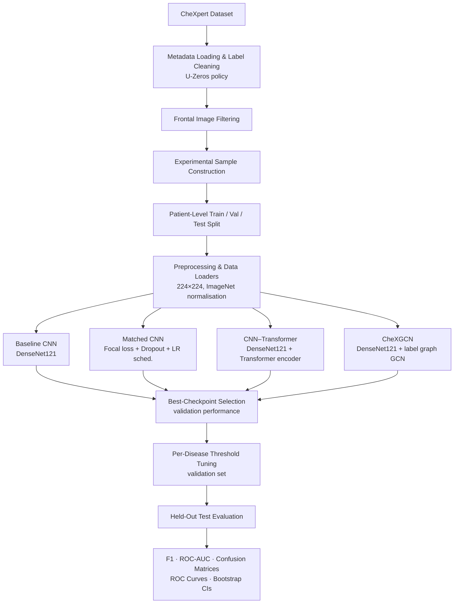
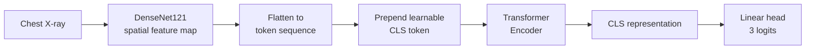
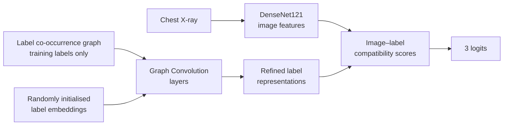

<div align="center">

# ReXTrust

### Multi-Label Chest X-ray Disease Detection Using CNN, CNN–Transformer, and Graph-Based Label Reasoning

**A comparative study on the CheXpert dataset: DenseNet121 · Hybrid CNN–Transformer · CheXGCN**


</div>

---

## Abstract

Automated analysis of chest radiographs is an active research area with the potential to support thoracic disease assessment. Reliable multi-label classification, however, depends on careful architectural choices, leakage-free data partitioning, and rigorous evaluation.

**ReXTrust** is a controlled comparative study of four deep-learning configurations for detecting three thoracic findings (**Cardiomegaly**, **Edema**, and **Pleural Effusion**) on the CheXpert dataset:

1. A **Baseline CNN** (ImageNet-pretrained DenseNet121)
2. A **Matched-Recipe CNN** (DenseNet121 with focal loss, dropout, and LR scheduling)
3. A **Hybrid CNN–Transformer** (DenseNet121 spatial features modelled by a Transformer encoder)
4. **CheXGCN** (image features combined with a graph convolutional network over disease labels)

All models share identical **patient-level** train/validation/test partitions, validation-based threshold tuning, and a common evaluation protocol (F1, ROC-AUC, confusion matrices, ROC curves, and 1,000-sample bootstrap confidence intervals).

> **Key finding:** On this experimental sample, the four architectures perform **broadly comparably**. The Baseline CNN attains the highest macro-averaged F1 and ROC-AUC, and no architecture dominates across every disease and metric. Differences between models are small and should be interpreted alongside the reported confidence intervals.

---

## Table of Contents

1. [Project Highlights](#1-project-highlights)
2. [Problem Statement](#2-problem-statement)
3. [Objectives and Research Questions](#3-objectives-and-research-questions)
4. [Dataset](#4-dataset)
5. [System Overview](#5-system-overview)
6. [Model Architectures](#6-model-architectures)
7. [Experimental Design](#7-experimental-design)
8. [Data Leakage Prevention](#8-data-leakage-prevention)
9. [Results](#9-results)
10. [Discussion](#10-discussion)
11. [Evaluation Metrics](#11-evaluation-metrics)
12. [Technology Stack](#12-technology-stack)
13. [Repository Structure](#13-repository-structure)
14. [Installation and Setup](#14-installation-and-setup)
15. [Usage](#15-usage)
16. [Reproducibility](#16-reproducibility)
17. [Limitations](#17-limitations)
18. [Future Work](#18-future-work)
19. [Responsible Use and Ethics](#19-responsible-use-and-ethics)
20. [Team and Acknowledgements](#20-team-and-acknowledgements)
21. [References](#21-references)

---

## 1. Project Highlights

| Aspect | Details |
|---|---|
| **Task** | Multi-label classification of 3 thoracic findings from frontal chest X-rays |
| **Dataset** | CheXpert (frontal views only) |
| **Experimental sample** | 71,811 images (from 191,027 cleaned frontal images) |
| **Architectures compared** | DenseNet121 · Matched DenseNet121 · CNN–Transformer · CheXGCN |
| **Split strategy** | Patient-level, no overlap verified (≈70 / 15 / 15) |
| **Threshold selection** | Per-disease, tuned on validation predictions only |
| **Metrics** | F1, ROC-AUC, Precision, Recall, Confusion Matrix |
| **Uncertainty** | Bootstrap confidence intervals (1,000 resamples) |
| **Compute** | Kaggle GPU notebooks |

---

## 2. Problem Statement

Chest X-ray interpretation is a core part of thoracic disease assessment. Automated image analysis can assist research into disease-associated visual patterns, but building a trustworthy classifier requires more than a high headline metric. It requires:

- **Sound architecture selection:** understanding what each model component contributes.
- **Leakage-free evaluation:** ensuring that images from one patient never appear in more than one partition.
- **Honest uncertainty reporting:** distinguishing real improvements from statistical noise.

This project investigates how **image feature extraction**, **spatial attention**, and **inter-label relationships** influence predictive performance for multi-label chest X-ray classification.

---

## 3. Objectives and Research Questions

### Objectives

- Develop a reproducible chest X-ray classification pipeline.
- Implement and compare CNN-based, Transformer-based, and graph-based approaches.
- Investigate the effect of different training strategies.
- Prevent patient-level data leakage across training, validation, and test sets.
- Tune classification thresholds using validation data only.
- Evaluate with F1 score and ROC-AUC, supported by confusion matrices and ROC curves.
- Quantify metric uncertainty using bootstrap confidence intervals.

### Research Questions

| # | Question |
|---|---|
| **RQ1** | Does changing the training recipe (loss, regularisation, LR scheduling) affect DenseNet121 performance? |
| **RQ2** | Does Transformer-based modelling of spatial feature relationships improve over a conventional CNN? |
| **RQ3** | Does explicitly modelling label co-occurrence with a graph network improve multi-label prediction? |
| **RQ4** | Are the observed performance differences large enough to be statistically meaningful? |

---

## 4. Dataset

The experiments use the **CheXpert** chest radiograph dataset, which provides chest X-ray images with associated radiology-report-derived labels.

### Target Findings

| Finding | Description |
|---|---|
| **Cardiomegaly** | Enlarged cardiac silhouette |
| **Edema** | Pulmonary edema |
| **Pleural Effusion** | Fluid accumulation in the pleural space |

### Preprocessing Pipeline

| Step | Operation |
|:---:|---|
| 1 | Load image metadata from `train.csv` |
| 2 | Handle uncertain labels using the **U-Zeros** policy |
| 3 | Replace missing target labels with zero |
| 4 | Retain **frontal-view** radiographs only |
| 5 | Extract patient identifiers from image paths |
| 6 | Build an experimental sample of disease-positive examples and examples negative for all three targets |
| 7 | Split the dataset at the **patient level** |
| 8 | Resize images to `224 × 224` |
| 9 | Apply ImageNet normalisation (for the pretrained DenseNet121 backbone) |

### Data Summary

The Stage 2 notebook reports **191,027** frontal images after label cleaning and a selected experimental sample of **71,811** images.

| Partition | Images | Share |
|---|---:|---:|
| Training | 50,403 | ≈ 70.2% |
| Validation | 10,653 | ≈ 14.8% |
| Test | 10,755 | ≈ 15.0% |
| **Total** | **71,811** | 100% |

> **Note:** The selected sample is not fully balanced across all possible label combinations. Performance should therefore be interpreted in the context of the sampling strategy and label distribution.

---

## 5. System Overview



### Experimental Workflow

1. Load and preprocess the dataset.
2. Construct patient-level data partitions.
3. Create shared data loaders (identical across all models).
4. Train each model with its designated training configuration.
5. Select the best checkpoint using validation performance.
6. Tune per-disease classification thresholds on validation predictions.
7. Evaluate selected models once on the held-out test set.
8. Compare per-disease F1 and ROC-AUC.
9. Examine confusion matrices, ROC curves, and bootstrap confidence intervals.

---

## 6. Model Architectures

### 6.1 Baseline CNN: DenseNet121

An ImageNet-pretrained **DenseNet121** backbone extracts visual features. Features pass through global average pooling and a linear layer producing three output logits.

| Setting | Value |
|---|---|
| Backbone | DenseNet121 (ImageNet-pretrained) |
| Head | Global average pooling → Linear (3 logits) |
| Loss | Binary Cross-Entropy with Logits |
| Optimiser | Adam |
| Prediction | Multi-label |

This model is the reference point for all other configurations.

### 6.2 Matched-Recipe CNN

Retains the DenseNet121 classification architecture but adopts a different training recipe, which is also used by the CNN–Transformer and CheXGCN models.

| Setting | Value |
|---|---|
| Loss | Focal loss |
| Dropout | `0.3` |
| LR scheduling | `ReduceLROnPlateau` |

Comparing it with the baseline isolates the effect of the **training recipe** while the architecture stays fixed.

### 6.3 Hybrid CNN–Transformer

Combines convolutional feature extraction with Transformer-based modelling of spatial relationships.



DenseNet121 produces a spatial feature map, which is converted into a token sequence with a learnable classification token. A Transformer encoder models relationships between spatial locations, and the resulting classification representation is passed to the output layer.

### 6.4 CheXGCN: Graph-Based Label Reasoning

Combines image features with graph-based modelling of relationships between disease labels.



- The **co-occurrence graph** is built from **training labels only** to avoid leakage.
- Label embeddings are **randomly initialised** (no pretrained text embeddings).
- Graph convolutional layers refine label representations; image-to-label compatibility scores yield the final predictions.

### 6.5 Comparison Strategy

The baseline uses a distinct training recipe; the other three share the matched recipe. This yields two clean comparisons:

| Comparison | What it isolates |
|---|---|
| **Baseline CNN vs. Matched CNN** | Effect of the training recipe |
| **Matched CNN vs. CNN–Transformer vs. CheXGCN** | Effect of architecture under identical training |

---

## 7. Experimental Design

### Configuration

| Parameter | Value |
|---|---|
| Random seed | `42` (Python, NumPy, PyTorch) |
| Image size | `224 × 224` |
| Batch size | `32` |
| Maximum epochs | `20` |
| Early-stopping patience | `4` |
| Checkpoint selection | Best validation performance |
| Threshold selection | Per-disease, on validation predictions |
| Bootstrap resamples | `1,000` |

### Design Principles

- **Controlled comparison:** identical data partitions and loaders for every model.
- **Validation-only tuning:** checkpoints and thresholds never use test data.
- **Single final test evaluation:** the test set is reserved for final reporting.
- **Uncertainty-aware reporting:** bootstrap CIs accompany point estimates.

---

## 8. Data Leakage Prevention

Patient-level leakage is a major concern in medical imaging because a single patient may contribute multiple images. If one patient appears in both training and test partitions, reported test performance can overestimate generalisation to unseen patients.

| Safeguard | Implementation |
|---|---|
| Patient ID extraction | Identifiers extracted **before** partitioning |
| Patient-level assignment | Each patient assigned to exactly one of train / val / test |
| Overlap verification | Explicit check that patient IDs do not overlap across partitions |
| Shared partitions | Same splits reused across all four models |
| Graph construction | CheXGCN co-occurrence graph built from **training labels only** |
| Threshold tuning | Performed on **validation** predictions only |
| Test isolation | Test partition reserved for final evaluation |

The notebook reports **no patient overlap** between the training, validation, and test partitions.

---

## 9. Results

Results are reported by the Stage 2 notebook (`rextrust-stage2-scaled-20k.ipynb`) using **validation-tuned thresholds** and **held-out test predictions**. Values are rounded to four decimal places; **bold** marks the best value in each row.

### 9.1 Test F1 Score

| Target Finding | Baseline CNN | Matched CNN | CNN–Transformer | CheXGCN |
|---|---:|---:|---:|---:|
| Cardiomegaly | 0.6640 | 0.6514 | **0.6652** | 0.6603 |
| Edema | **0.6987** | **0.6987** | 0.6856 | 0.6928 |
| Pleural Effusion | 0.7722 | 0.7664 | 0.7701 | **0.7727** |
| *Macro average* | **0.7116** | 0.7055 | 0.7070 | 0.7086 |

### 9.2 Test ROC-AUC

| Target Finding | Baseline CNN | Matched CNN | CNN–Transformer | CheXGCN |
|---|---:|---:|---:|---:|
| Cardiomegaly | **0.8546** | 0.8470 | 0.8527 | 0.8503 |
| Edema | 0.8080 | **0.8122** | 0.8004 | 0.8052 |
| Pleural Effusion | **0.8620** | 0.8548 | 0.8576 | 0.8614 |
| *Macro average* | **0.8415** | 0.8380 | 0.8369 | 0.8390 |

> Macro averages are the unweighted means of the three per-disease values above, computed for summary purposes. Edema F1 is tied between the Baseline and Matched CNN at the reported precision.

### 9.3 Best Model per Finding

| Finding | Best F1 | Best ROC-AUC |
|---|---|---|
| Cardiomegaly | CNN–Transformer (0.6652) | Baseline CNN (0.8546) |
| Edema | Baseline CNN / Matched CNN (0.6987, tie) | Matched CNN (0.8122) |
| Pleural Effusion | CheXGCN (0.7727) | Baseline CNN (0.8620) |

### 9.4 Additional Analyses (Generated by the Notebook)

- Per-disease confusion matrices
- ROC curves for all models and findings
- Bootstrap confidence intervals (1,000 resamples) for selected test metrics

---

## 10. Discussion

### Findings by Research Question

| RQ | Observation |
|---|---|
| **RQ1: Training recipe** | The matched recipe (focal loss, dropout 0.3, `ReduceLROnPlateau`) did not improve over the baseline recipe; the Matched CNN is equal or slightly lower on most metrics. |
| **RQ2: Transformer** | The CNN–Transformer achieved the best Cardiomegaly F1 but was the lowest on macro ROC-AUC and on Edema, so there is no consistent benefit over the CNN. |
| **RQ3: Graph reasoning** | CheXGCN achieved the best Pleural Effusion F1 and is competitive overall, but its macro scores do not exceed the baseline. |
| **RQ4: Significance** | Macro-level gaps between models are on the order of 0.005 to 0.01. Such small differences should be judged against the bootstrap confidence intervals before claiming superiority. |

### Interpretation

- **A strong pretrained CNN is a hard baseline to beat** in this setting. Added architectural complexity did not translate into consistent gains.
- **Edema is the most challenging finding** (lowest ROC-AUC for every model), whereas **Pleural Effusion is the most reliably detected**.
- With only **three labels** and a **randomly initialised label graph**, the potential benefit of label-relationship modelling is likely limited. Richer label sets and semantic embeddings may change this conclusion (see [Future Work](#18-future-work)).
- All conclusions are conditional on the sampling strategy, the U-Zeros label policy, and the internal test split.

---

## 11. Evaluation Metrics

| Metric | Purpose |
|---|---|
| **Precision** | Proportion of predicted positives that are truly positive |
| **Recall / Sensitivity** | Proportion of actual positives that are detected |
| **F1 Score** | Harmonic mean of precision and recall (threshold-dependent) |
| **ROC-AUC** | Ability to rank positives above negatives across all thresholds (threshold-independent) |
| **Confusion Matrix** | Counts of true/false positives and negatives |
| **Bootstrap CI** | Uncertainty estimate through repeated resampling of the test set |

Per-disease thresholds are selected on **validation** predictions and then applied to **test** predictions for threshold-dependent metrics such as F1. ROC-AUC is computed directly from predicted probabilities.

---

## 12. Technology Stack

| Category | Technology | Purpose |
|---|---|---|
| Language | Python | Primary implementation language |
| Deep learning | PyTorch | Model development and training |
| Vision | Torchvision | Transforms and pretrained DenseNet121 |
| Graph learning | PyTorch Geometric | CheXGCN implementation |
| Data | pandas, NumPy | Metadata processing and numerics |
| Imaging | OpenCV | Image-processing support |
| Evaluation | scikit-learn | Metrics and analysis |
| Visualisation | Matplotlib | Plots and result figures |
| Environment | Jupyter, Kaggle Notebooks | Experimentation and GPU compute |

---

## 13. Repository Structure

```text
VLIL-Team-95/
└── DiseaseDetection/
    ├── Models/                                              # Model-related assets
    ├── dataset-loading.ipynb                                # Dataset loading and preparation
    ├── diseasedetectiondensenet121.ipynb                    # DenseNet121 experiments
    ├── fork-of-diseasedetectiondensenet121.ipynb            # Forked DenseNet121 variant
    ├── rextrust-stage2-scaled-1k.ipynb                      # Scaled experiment (1k)
    ├── rextrust-stage2-scaled-6k.ipynb                      # Scaled experiment (6k)
    ├── rextrust-stage2-scaled-20k.ipynb                     # MAIN Stage 2 four-model comparison
    ├── fork-of-rextrust-stage2-scaled-20k.ipynb             # Forked 20k variant
    └── final-rextrust-stage2-scaled-6k-umasked-chexgcn.ipynb  # CheXGCN-focused experiment
```

| Notebook | Role |
|---|---|
| `dataset-loading.ipynb` | Dataset loading and preparation workflow |
| `diseasedetectiondensenet121.ipynb` | DenseNet121-based disease detection experiments |
| `rextrust-stage2-scaled-1k.ipynb` / `-6k.ipynb` | Smaller-scale ReXTrust experiments |
| **`rextrust-stage2-scaled-20k.ipynb`** | **Main Stage 2 model comparison described in this README** |
| `final-rextrust-stage2-scaled-6k-umasked-chexgcn.ipynb` | CheXGCN-related experiment |
| `Models/` | Model-related assets |

> Notebook contents and dataset paths may differ between experimental versions. Use the intended notebook when reproducing a specific set of results.

---

## 14. Installation and Setup

### Prerequisites

- Python 3.10 or a compatible version supported by your installed libraries
- Access to the **CheXpert** dataset under its applicable access and usage terms
- Jupyter Notebook or Kaggle Notebooks
- A CUDA-capable GPU (recommended for training)

### Step 1: Clone the Repository

```bash
git clone https://github.com/SuryaSampreeth/VLIL-Team-95.git
cd VLIL-Team-95/DiseaseDetection
```

### Step 2: Create a Virtual Environment

**Windows (PowerShell)**

```powershell
python -m venv .venv
.venv\Scripts\Activate.ps1
```

**Linux / macOS**

```bash
python3 -m venv .venv
source .venv/bin/activate
```

### Step 3: Install Dependencies

```bash
python -m pip install --upgrade pip
python -m pip install numpy pandas matplotlib opencv-python scikit-learn jupyter
```

Then install the deep-learning libraries using their official selectors:

- **PyTorch and Torchvision:** https://pytorch.org/get-started/locally/
- **PyTorch Geometric** (required for CheXGCN): https://pytorch-geometric.readthedocs.io/en/latest/install/installation.html

> **Note:** The repository does not currently provide a verified, fully pinned dependency lockfile. Select package versions according to your Python, CUDA, and PyTorch versions.

### Step 4: Configure the Dataset Path

The main notebook uses a Kaggle-style path similar to:

```python
DATA_ROOT = "/kaggle/input/datasets/ashery/chexpert/"
```

Update `DATA_ROOT` to your dataset location and confirm that `train.csv` and the corresponding image files are accessible.

---

## 15. Usage

### Option A: Local Jupyter

```bash
jupyter notebook
```

Open `rextrust-stage2-scaled-20k.ipynb` and run the cells in order.

### Option B: Kaggle Notebooks

1. Open the notebook in Kaggle.
2. Attach the required CheXpert dataset.
3. Enable a **GPU accelerator**.
4. Verify `DATA_ROOT`.
5. Run all cells in order.
6. Review the final metric tables, confusion matrices, ROC curves, and bootstrap confidence intervals.

> Training all four configurations requires substantial GPU time and memory. If you change the sample size, epoch count, or model configuration, document the changes and treat the result as a separate experiment.

---

## 16. Reproducibility

Random seeds are set for Python, NumPy, and PyTorch with `SEED = 42`. Seeds improve repeatability but **do not guarantee identical results** across hardware, CUDA versions, library versions, or data-loading configurations.

### Reproducibility Checklist

- [ ] Dataset version and sampling configuration
- [ ] Patient-level split details
- [ ] Python, PyTorch, Torchvision, CUDA, and PyTorch Geometric versions
- [ ] Model architecture and training configuration
- [ ] Checkpoint-selection criteria
- [ ] Validation-selected thresholds
- [ ] Test metrics and bootstrap confidence intervals

---

## 17. Limitations

| Area | Limitation |
|---|---|
| **Scope** | Only three of the available CheXpert findings are studied |
| **Sampling** | Sampling and label-processing choices affect target prevalence; the sample is not fully balanced across label combinations |
| **Generalisation** | Results come from an internal held-out test split; external validation is not established |
| **Label noise** | Labels are derived from radiology reports and the U-Zeros policy treats uncertain labels as negative |
| **CheXGCN** | Label embeddings are random rather than pretrained semantic embeddings |
| **Effect sizes** | Differences between models are small for several comparisons and must be read with the bootstrap CIs |
| **Interpretability** | Predictions and visual explanations may be wrong and are not proof of clinical reasoning |
| **Clinical readiness** | Clinical utility and regulatory approval have not been established |

---

## 18. Future Work

- Extend experiments to additional thoracic findings and the full CheXpert label set.
- Validate on independent datasets and institutions (external validation).
- Study probability **calibration** and clinically meaningful operating thresholds.
- Compare alternative graph-construction methods and **pretrained label embeddings**.
- Evaluate alternative uncertain-label policies (e.g. U-Ones, U-Ignore, label smoothing).
- Perform error analysis of false positives and false negatives with expert review.
- Assess subgroup performance where appropriate data and governance allow.
- Investigate explainability methods (e.g. Grad-CAM) and validate their reliability.
- Improve experiment tracking and dependency version pinning.

---

## 19. Responsible Use and Ethics

This project is intended for **research and educational purposes only**. It is **not a medical device** and must not be used as a substitute for professional medical assessment.

- Model predictions may be incorrect and may not generalise across hospitals, populations, scanners, or imaging protocols.
- Any potential clinical application would require external validation, clinical oversight, privacy and security review, and applicable regulatory approval.
- Use the dataset according to its access conditions and usage terms.
- **Do not commit** patient data, credentials, access tokens, or other sensitive information to this repository.

---

## 20. Team and Acknowledgements

### Project Team

| Role | Name |
|---|---|
| Team | VLIL Team 95 |
| Members | *[Add member names and roll numbers]* |
| Supervisor / Guide | *[Add supervisor name]* |
| Institution / Department | *[Add institution and department]* |

### Acknowledgements

- The authors and maintainers of the **CheXpert** dataset.
- The researchers whose work on DenseNet, Transformers, and graph neural networks informs these experiments.
- The open-source communities behind PyTorch, Torchvision, NumPy, pandas, scikit-learn, OpenCV, and PyTorch Geometric.

---

## 21. References

1. J. Irvin et al., "CheXpert: A Large Chest Radiograph Dataset with Uncertainty Labels and Expert Comparison," *AAAI*, 2019.
2. G. Huang, Z. Liu, L. van der Maaten, K. Q. Weinberger, "Densely Connected Convolutional Networks," *CVPR*, 2017.
3. A. Vaswani et al., "Attention Is All You Need," *NeurIPS*, 2017.
4. T. N. Kipf and M. Welling, "Semi-Supervised Classification with Graph Convolutional Networks," *ICLR*, 2017.
5. Z.-M. Chen et al., "Multi-Label Image Recognition with Graph Convolutional Networks," *CVPR*, 2019.
6. T.-Y. Lin et al., "Focal Loss for Dense Object Detection," *ICCV*, 2017.
7. B. Efron, "Bootstrap Methods: Another Look at the Jackknife," *The Annals of Statistics*, 1979.

---

<div align="center">

**ReXTrust: Stage 2, Chest X-ray Disease Detection**

*For research and educational use only. Update this documentation whenever the dataset, implementation, experimental configuration, or reported results change.*

</div>
