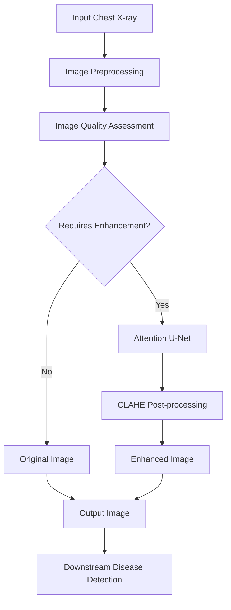
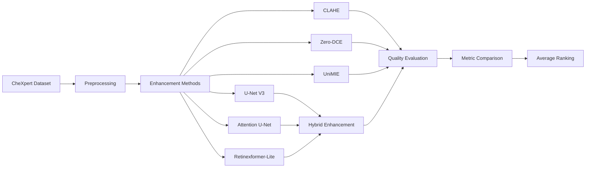
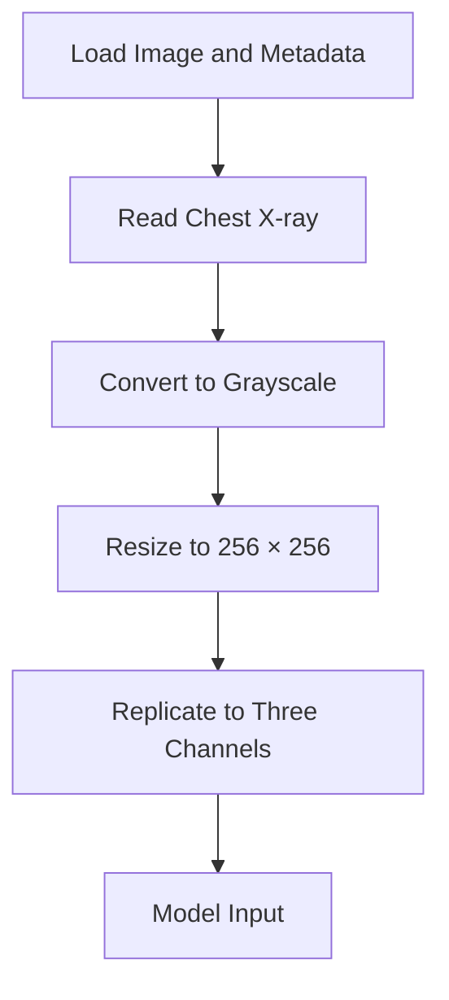
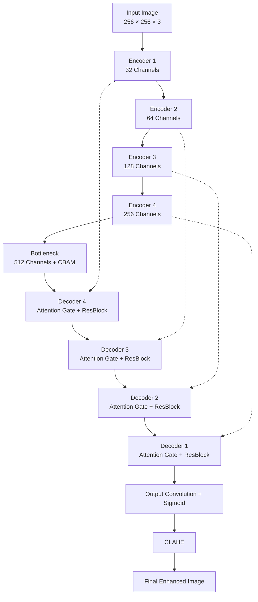
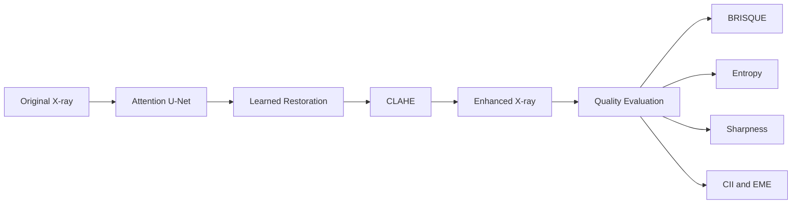
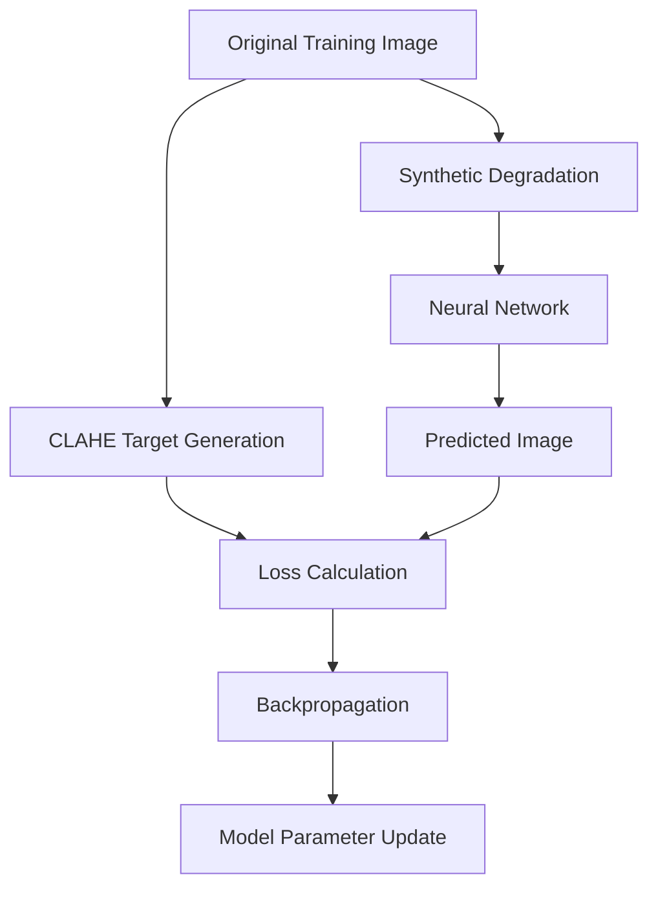
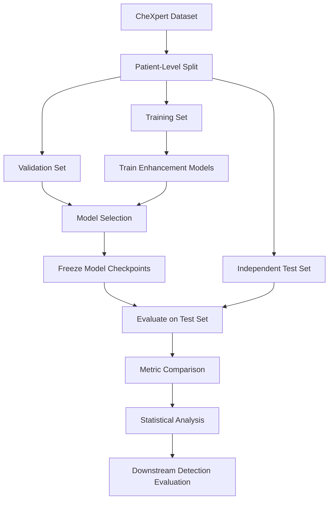

# ReXTrust: Chest X-ray Image Enhancement

### A Comparative Study of Classical, Deep Learning, Attention-Based, and Hybrid Enhancement Methods


> **Final Year Project, B.Tech Computer Science & Engineering**
> Amrita Vishwa Vidyapeetham, Coimbatore
> **Project:** ReXTrust | **Team:** VLIL Team 95
> **Members:** [Name 1], [Name 2], [Name 3] | **Guide:** [Guide Name] | **Academic Year:** [Year]
> **Domain:** Medical Image Processing · Deep Learning · Computer Vision

---

## Table of Contents

1. [Abstract](#1-abstract)
2. [Key Results at a Glance](#2-key-results-at-a-glance)
3. [Motivation, Problem Statement and Research Questions](#3-motivation-problem-statement-and-research-questions)
4. [Contributions](#4-contributions)
5. [System Architecture](#5-system-architecture)
6. [Dataset and Preprocessing](#6-dataset-and-preprocessing)
7. [Enhancement Methods](#7-enhancement-methods)
8. [Proposed Method: Attention U-Net + CLAHE](#8-proposed-method-attention-u-net--clahe)
9. [Training Configuration](#9-training-configuration)
10. [Evaluation Metrics](#10-evaluation-metrics)
11. [Experimental Results](#11-experimental-results)
12. [Discussion](#12-discussion)
13. [Limitations and Data Leakage Audit](#13-limitations-and-data-leakage-audit)
14. [Repository Structure](#14-repository-structure)
15. [Installation](#15-installation)
16. [Execution](#16-execution)
17. [Reproducibility](#17-reproducibility)
18. [Future Work](#18-future-work)
19. [Responsible Use](#19-responsible-use)
20. [References](#20-references)
21. [Citation](#21-citation)
22. [Team, Acknowledgements and License](#22-team-acknowledgements-and-license)

---

## 1. Abstract

Chest X-ray images are susceptible to low contrast, noise, and uneven illumination. These defects can reduce the visibility of anatomical structures and degrade downstream medical-image analysis. This project studies enhancement methods that improve visual quality while minimizing the loss of diagnostically relevant information.

We compare classical image processing, unsupervised enhancement, diffusion-based enhancement, supervised neural networks, attention-based architectures, and hybrid pipelines on the **CheXpert** chest radiograph dataset.

The principal contribution is an **Attention U-Net + CLAHE hybrid pipeline**. It combines learned restoration with contrast-limited adaptive histogram equalization. The Attention U-Net uses residual blocks, a Convolutional Block Attention Module (CBAM), and attention-gated skip connections. Quality is measured with BRISQUE, Shannon entropy, Laplacian-variance sharpness, the Contrast Improvement Index (CII), and Enhancement Measure Evaluation (EME).

On the documented evaluation of 23 selected images, Attention U-Net + CLAHE achieved the best average rank (**2.2 across eight methods**), the highest mean entropy (**7.92**), and the highest mean CII (**1.90**). These results are **preliminary**. The evaluation subset was selected using metrics that are also used for scoring, and training and evaluation images may overlap. Patient-level, leakage-free validation is required before any general conclusion is drawn.

---

## 2. Key Results at a Glance

| Item | Value |
|---|---|
| Proposed method | Attention U-Net + CLAHE |
| Methods compared (multi-image) | 8 |
| Methods compared (single image) | 10 |
| Evaluation images (multi-image) | 23 (flagged low-quality subset) |
| Average rank, proposed method | **2.2** (best of 8) |
| Mean entropy / mean CII | **7.92 / 1.90** (highest of 8) |
| Model size | 8,235,421 parameters (about 31.42 MiB in float32) |
| Fine-edge retention (support-device image) | 98.9% |
| Main caveat | Possible training/evaluation overlap and metric-based image selection |

---

## 3. Motivation, Problem Statement and Research Questions

### 3.1 Motivation

Poor image quality can obscure lung fields, devices, and subtle opacities. Classical enhancement can amplify noise. Deep-learning enhancement can smooth fine structures or introduce artifacts. Enhancement therefore needs to be compared across several quality dimensions, not judged by one number.

### 3.2 Problem Statement

*Develop and evaluate chest X-ray enhancement techniques that balance contrast improvement, noise suppression, structural preservation, sharpness, and computational efficiency, and identify the methodological conditions under which such comparisons are reliable.*

### 3.3 Objectives

1. Implement and compare multiple chest X-ray enhancement techniques.
2. Develop an attention-based U-Net with residual blocks and CBAM.
3. Investigate hybrid pipelines that combine neural restoration with CLAHE.
4. Evaluate enhanced images with complementary image-quality metrics.
5. Examine preservation of fine structures, including support-device edges.
6. Compare methods on a common experimental subset.
7. Identify data leakage and methodological limitations.

### 3.4 Research Questions

| ID | Research Question |
|---|---|
| RQ1 | Does combining neural restoration with CLAHE improve enhancement quality compared with either method alone? |
| RQ2 | Do attention mechanisms improve the performance of a conventional U-Net? |
| RQ3 | How do classical, unsupervised, diffusion-based, and learned enhancement approaches compare? |
| RQ4 | Are fine image structures preserved after enhancement? |
| RQ5 | How reliable are the observed improvements under an independent evaluation protocol? |

---

## 4. Contributions

1. A comparative benchmark of **ten enhancement configurations** spanning classical, unsupervised, diffusion-based, supervised, attention-based, transformer-inspired, and hybrid methods.
2. An **Attention U-Net** with residual blocks, a CBAM bottleneck, and attention-gated skip connections, combined with CLAHE post-processing.
3. A **multi-metric evaluation** (BRISQUE, entropy, sharpness, CII, EME) with a rank-aggregation scheme that respects each metric's preferred direction.
4. A **conditional enhancement workflow** that applies enhancement only to images flagged by quality thresholds.
5. A **data-leakage audit** that documents training/evaluation overlap and a recommended patient-level validation protocol.
6. An **edge-preservation check** on a support-device radiograph.

---

## 5. System Architecture

The enhancement module is designed as an image-quality assessment and enhancement stage within the broader ReXTrust pipeline.

### 5.1 Conditional Enhancement Workflow



The quality-assessment stage uses BRISQUE and entropy thresholds. These thresholds are experimental and have not been clinically validated.

### 5.2 Enhancement Module Workflow



---

## 6. Dataset and Preprocessing

### 6.1 Dataset

Experiments use the **CheXpert** chest radiograph dataset, which contains chest X-ray images and radiology-derived labels. The notebooks load image metadata from `train.csv` and optionally reference `valid.csv`.

```python
BASE_PATH = "/kaggle/input/datasets/ashery/chexpert"

TRAIN_CSV = f"{BASE_PATH}/train.csv"
VALID_CSV = f"{BASE_PATH}/valid.csv"
```

Update `BASE_PATH` for the environment in which the notebooks are run.

### 6.2 Preprocessing Pipeline



Images are converted to grayscale, resized to 256 × 256, and replicated to three channels for networks that expect three-channel input.

### 6.3 Experimental Subsets

| Subset | Number of Images | Purpose |
|---|---:|---|
| Initial random sample | 50 | Quality screening |
| Flagged low-quality subset | 23 | Multi-image evaluation |
| Single-image subset | 1 | Detailed ten-method comparison |
| Support-device example | 1 | Edge-preservation assessment |

### 6.4 Quality Screening Rule

An image is flagged for enhancement when either condition holds:

```text
BRISQUE > 5.0  OR  Entropy < 7.95
```

These are experimental thresholds, not clinically established criteria. Because BRISQUE and entropy are also evaluation metrics, selecting the 23-image subset with them **introduces selection bias**.

---

## 7. Enhancement Methods

| Method | Category | Description |
|---|---|---|
| Original | Reference | Unprocessed input image |
| CLAHE | Classical | Local histogram equalization with contrast limiting |
| Zero-DCE | Unsupervised deep learning | Pixel-wise enhancement curve estimation |
| UniMIE | Diffusion-based | Diffusion-model-based image enhancement |
| U-Net V3 | Supervised deep learning | Encoder-decoder restoration network |
| U-Net V3 + CLAHE | Hybrid | Neural restoration followed by CLAHE |
| Attention U-Net | Attention-based deep learning | Residual blocks, CBAM, attention gates |
| **Attention U-Net + CLAHE** | **Proposed hybrid** | Attention-based restoration followed by CLAHE |
| Retinexformer-Lite | Transformer-inspired | Illumination-guided feature processing |
| Retinexformer-Lite + CLAHE | Hybrid | Illumination-aware enhancement followed by CLAHE |

### 7.1 CLAHE
Equalizes intensity distributions within image tiles while limiting contrast amplification. It is fast and training-free, but it can amplify noise and produce excessive local contrast.

### 7.2 Zero-DCE
Estimates pixel-wise enhancement curves with a lightweight CNN. It is trained without reference images, using spatial-consistency, exposure-control, color-constancy, and illumination-smoothness losses.

### 7.3 UniMIE
Uses a pretrained diffusion checkpoint with the guided-diffusion implementation. Generative enhancement can alter fine details, so outputs need careful visual and quantitative review.

### 7.4 U-Net V3
An encoder-decoder with skip connections, trained to map synthetically degraded images to CLAHE-generated targets. The loss combines L1 reconstruction, SSIM-based structural loss, and Laplacian edge loss.

> Because the targets are produced by CLAHE, the network learns the characteristics of that target-generation procedure, not a verified ideal clinical image.

### 7.5 Retinexformer-Lite
A simplified, Retinexformer-inspired network that uses illumination-guided multi-head self-attention. An illumination estimator produces a light map that modulates feature processing. It is an adaptation, not an exact reproduction of the original Retinexformer.

---

## 8. Proposed Method: Attention U-Net + CLAHE

### 8.1 Methodology

The Attention U-Net reconstructs image features through residual blocks, channel and spatial attention (CBAM), and attention-gated skip connections. CLAHE is then applied to the network output to improve local contrast.

### 8.2 Architecture



### 8.3 Components

| Component | Role |
|---|---|
| Residual blocks | Learn feature corrections and support gradient flow |
| Encoder | Extract hierarchical image features |
| CBAM | Apply channel and spatial attention at the bottleneck |
| Attention gates | Filter encoder features before skip-connection fusion |
| Decoder | Reconstruct higher-resolution features |
| Output convolution | Produce the restored image |
| CLAHE | Enhance local contrast after restoration |

### 8.4 Model Specifications

| Parameter | Value |
|---|---|
| Input resolution | 256 × 256 |
| Input channels | 3 |
| Encoder stages | 4 |
| Bottleneck channels | 512 |
| Attention mechanisms | CBAM and attention gates |
| Trainable parameters | 8,235,421 |
| Float32 model size | About 31.42 MiB |
| Post-processing | CLAHE |

### 8.5 Hybrid Processing Flow



The design aims to combine learned reconstruction with controlled local contrast enhancement. Its effectiveness has to be established by independent evaluation, not assumed from the architecture.

---

## 9. Training Configuration

### 9.1 Synthetic Training Data

Supervised models take synthetically degraded images as input and CLAHE-generated images as targets. The degradation includes Gaussian noise and Gaussian blur.



### 9.2 Training Settings

| Setting | U-Net V3 | Attention U-Net | Retinexformer-Lite |
|---|---|---|---|
| Optimizer | Adam | Adam | Adam |
| Learning rate | 3 × 10⁻⁴ | 3 × 10⁻⁴ | 3 × 10⁻⁴ |
| Maximum epochs | 60 | 60 | 60 |
| Batch size | 8 | 8 | 8 |
| Training images | 1,900 | 400 | 1,799 |
| Validation images | 100 | 100 | 200 |
| Loss | L1 + SSIM + Laplacian | L1 + SSIM + Laplacian | Same + illumination smoothness |
| Scheduler | ReduceLROnPlateau | ReduceLROnPlateau | ReduceLROnPlateau |
| Hardware | Tesla T4 | Tesla T4 | Tesla T4 |

Verify settings and data splits against the notebooks before reproducing results.

---

## 10. Evaluation Metrics

No single number characterizes enhancement quality, so five complementary metrics are used.

| Metric | Preferred Direction | Purpose |
|---|---|---|
| BRISQUE | Lower | Perceptual quality estimate (no reference) |
| Shannon entropy | Higher, with caution | Information content of the intensity distribution |
| Sharpness (Laplacian variance) | Higher, with caution | High-frequency detail |
| CII | Higher | Contrast improvement relative to the original |
| EME | Higher, with caution | Local contrast across image blocks |

### 10.1 Definitions

```text
Entropy      H = − Σ p(i) · log2 p(i)                 (p = normalized gray-level histogram)
Sharpness    S = Var( ∇²I )                            (variance of the Laplacian)
CII          CII = C_enhanced / C_original             (original = 1.00 by construction)
EME          EME = (1 / k1k2) · Σ 20 · log( Imax / Imin )   (over k1 × k2 blocks)
```

### 10.2 Interpretation Notes

- **BRISQUE** is built on natural-image statistics, so its interpretation on radiographs is limited.
- **Entropy** and **sharpness** can both rise because of noise, so a higher value is not always better.
- **EME** reflects local contrast and does not guarantee anatomical preservation.
- **CII** is relative to the original, so the original is always 1.00.

### 10.3 Average Ranking

Methods are ranked on each metric separately, respecting its preferred direction, and the ranks are averaged. A lower average rank means a better overall ranking across the selected metrics. It does **not** mean better clinical performance.

---

## 11. Experimental Results

### 11.1 Multi-Image Evaluation (23 images, 8 methods)

| Rank | Method | BRISQUE ↓ | Entropy ↑ | Sharpness ↑ | CII ↑ | EME ↑ | Average Rank |
|---:|---|---:|---:|---:|---:|---:|---:|
| 1 | **Attention U-Net + CLAHE** | 13.35 | **7.92** | 2082.26 | **1.90** | 11.10 | **2.2** |
| 2 | U-Net V3 + CLAHE | 17.51 | 7.91 | 1859.65 | 1.76 | 10.76 | 3.2 |
| 3 | CLAHE | 7.01 | 7.84 | **3609.61** | 1.71 | 8.65 | 3.8 |
| 4 | Attention U-Net | 13.22 | 7.86 | 1295.71 | 1.37 | 7.90 | 4.6 |
| 5 | Original | 5.62 | 7.85 | 534.33 | 1.00 | 9.54 | 5.2 |
| 6 | Zero-DCE | 19.59 | 6.54 | 1766.44 | 1.27 | **12.16** | 5.4 |
| 7 | U-Net V3 | 17.96 | 7.86 | 1190.87 | 1.29 | 7.71 | 5.6 |
| 8 | UniMIE | -0.81 | 7.85 | 725.65 | 0.93 | 5.44 | 6.0 |

Retinexformer-Lite and Retinexformer-Lite + CLAHE were evaluated only in the single-image comparison.

### 11.2 Key Findings

- Attention U-Net + CLAHE obtained the best average rank (**2.2**), with the highest mean entropy and CII.
- CLAHE obtained the highest sharpness, but sharpness can increase through noise amplification.
- Zero-DCE obtained the highest EME and the lowest entropy.
- UniMIE obtained the lowest BRISQUE, but its CII was below 1.0.
- The proposed method's BRISQUE (13.35) is **worse** than that of the Original (5.62) and CLAHE (7.01), which shows the trade-off between contrast gain and BRISQUE's natural-image bias.
- No method was best on every metric.

### 11.3 Single-Image Comparison (`view2_lateral.jpg`, 10 methods)

| Rank | Method | BRISQUE ↓ | Entropy ↑ | Sharpness ↑ | CII ↑ | EME ↑ | Average Rank |
|---:|---|---:|---:|---:|---:|---:|---:|
| 1 | **Attention U-Net + CLAHE** | 1.50 | 7.37 | 1621.70 | 1.79 | 8.46 | 1.8 |
| 2 | U-Net V3 + CLAHE | 22.89 | 7.29 | 821.18 | 1.37 | 7.57 | 4.4 |
| 3 | Retinexformer-Lite + CLAHE | 21.62 | 7.33 | 593.43 | 1.39 | 7.55 | 4.4 |
| 4 | CLAHE | 6.72 | 6.85 | 2212.86 | 1.28 | 5.73 | 4.8 |
| 5 | Zero-DCE | 14.74 | 5.43 | 876.06 | 1.16 | 21.41 | 5.0 |
| 6 | Attention U-Net | 8.50 | 7.05 | 777.61 | 1.24 | 5.98 | 5.2 |
| 7 | U-Net V3 | 33.58 | 7.12 | 491.36 | 1.07 | 6.23 | 6.8 |
| 8 | UniMIE | 1.01 | 7.00 | 366.94 | 0.88 | 4.34 | 7.0 |
| 9 | Original | 19.22 | 6.79 | 285.95 | 1.00 | 18.38 | 7.2 |
| 10 | Retinexformer-Lite | 28.28 | 6.93 | 297.79 | 1.01 | 5.66 | 8.4 |

Single-image results are illustrative and cannot establish general superiority.

### 11.4 Edge Preservation

| Method | Fine-Edge Retention |
|---|---:|
| CLAHE | 98.6% |
| Attention U-Net | 99.1% |
| Attention U-Net + CLAHE | 98.9% |

This check uses one support-device image and a Canny edge comparison. It measures retained edges, not newly introduced edges or semantic preservation.

### 11.5 Statistical Comparison

A paired Wilcoxon signed-rank test compared Attention U-Net + CLAHE with U-Net V3 + CLAHE over 23 image pairs.

| Metric | Reported p-value |
|---|---:|
| BRISQUE | 0.0003 |
| Entropy | 0.0001 |
| Sharpness | 0.0049 |
| CII | < 0.0001 |
| EME | 0.0001 |

The p-values are reported **uncorrected**. For reference, a Bonferroni threshold for five tests is α = 0.05 / 5 = 0.01, and every reported value falls below it. This does not remove the concerns about evaluation-image overlap and selection bias (see Section 13), so the p-values must not be read as evidence of clinical benefit.

### 11.6 Mapping Results to Research Questions

| RQ | Preliminary observation | Confidence |
|---|---|---|
| RQ1 | Hybrid variants ranked above their non-CLAHE counterparts on average rank. | Low (small, possibly leaked subset) |
| RQ2 | Attention U-Net + CLAHE ranked above U-Net V3 + CLAHE. | Low (the two models used different training pools) |
| RQ3 | Learned hybrids and CLAHE ranked above Zero-DCE and UniMIE on average rank. | Low |
| RQ4 | Edge retention was 98.6–99.1% on one support-device image. | Very low (n = 1) |
| RQ5 | Reliability is **not established**; leakage-free re-evaluation is required. | N/A |

---

## 12. Discussion

- **Complementary strengths.** CLAHE contributes strong local contrast and sharpness, and the learned network contributes smoother, structure-aware restoration. The hybrid ranks best overall because it balances several metrics, not because it wins each one.
- **Metric disagreement.** BRISQUE favors the unprocessed image and UniMIE, while CII, entropy, and EME favor contrast-enhanced outputs. This is why multi-metric ranking is used, and why expert assessment is needed.
- **CLAHE-as-target effect.** U-Net V3, Attention U-Net, and Retinexformer-Lite are trained to imitate CLAHE. Their gains over CLAHE alone must be read in that light.
- **Cost.** Diffusion-based enhancement (UniMIE) dominates the roughly 15-minute multi-image runtime on a Tesla T4, while CLAHE needs no training and almost no compute.

---

## 13. Limitations and Data Leakage Audit

### 13.1 Potential Training-Evaluation Overlap

| Model | Documented Status |
|---|---|
| U-Net V3 | 18 of 23 evaluation images overlap with its training pool |
| Attention U-Net | Potential overlap with all 23 evaluation images |
| Retinexformer-Lite | Notebook includes a leakage guard |
| Zero-DCE | Overlap not fully verified |
| CLAHE | No training-related leakage |
| UniMIE | Uses a pretrained diffusion model |

The Attention U-Net training pool and the evaluation subset were produced by related sampling procedures with the same random seed, so evaluation images may have been included in training or validation. The overlap should be verified from the actual image-path lists. Patient-level separation is also needed, since different images of one patient may appear in several subsets.

### 13.2 Additional Limitations

- Small evaluation subset.
- Evaluation images selected using metrics that are later used for assessment.
- No clinically ideal reference images.
- Limited suitability of BRISQUE for radiographs.
- Entropy and sharpness can rise because of noise.
- Supervised models learn from CLAHE-generated targets.
- Artifact preservation assessed on a single image.
- Uncorrected statistical comparisons.
- Incomplete multi-image comparison of all ten configurations.
- No demonstrated improvement in downstream disease-detection accuracy.
- Training pool sizes differ across models (400 to 1,900 images), which confounds model comparison.

### 13.3 Recommended Validation Protocol



1. Split data at the patient level before training.
2. Exclude all test patients from training and validation.
3. Select test images independently of evaluation metrics.
4. Compare every method on the same fixed test set.
5. Report uncertainty and correct for multiple comparisons.
6. Evaluate the effect of enhancement on downstream disease detection.
7. Obtain expert assessment before making any clinical claim.

---

## 14. Repository Structure

```text
Image_enhancement/
|
|-- results/
|   |-- artifact_highlighted_full.png
|   |-- comparision_table (2).png
|   |-- five_way_comparison_v3.png
|   |-- four_way_comparison_clean.png
|   |-- multi_image_eval_barchart.png
|   |-- quality_distribution.png
|   |-- single_image_comparison.png
|   |-- texture_blurring_verification.png
|   |-- unet_xray_v3.pt
|   |-- zerodce_training_loss.png
|   |-- zerodce_xray.pt
|
|-- README.md
|-- final_image_enhacement_3000.ipynb
|-- final-image-enhancement-with-attention.ipynb
|-- final-image-enhancement.ipynb
|-- final_image_enhancement_23_images.ipynb
|-- image_enhancement_stage_1.ipynb
|-- image_enhancement_unimie.ipynb
|-- unet_xray_v3.pt
|-- zerodce_xray.pt
```

| File | Description |
|---|---|
| `final_image_enhacement_3000.ipynb` | Consolidated enhancement and evaluation experiments |
| `final-image-enhancement-with-attention.ipynb` | Attention-based enhancement experiments |
| `final-image-enhancement.ipynb` | Image enhancement pipeline |
| `final_image_enhancement_23_images.ipynb` | Multi-image comparison and artifact assessment |
| `image_enhancement_stage_1.ipynb` | Initial enhancement workflow |
| `image_enhancement_unimie.ipynb` | Diffusion-based enhancement |
| `unet_xray_v3.pt` | U-Net V3 checkpoint |
| `zerodce_xray.pt` | Zero-DCE checkpoint |
| `results/` | Saved evaluation outputs and figures |

File names are reproduced as they appear in the repository, including existing spelling (`enhacement`, `comparision`). Update this tree if the repository changes.

### Result Figures

| Figure | File |
|---|---|
| Multi-image metric bar chart | `results/multi_image_eval_barchart.png` |
| Single-image comparison | `results/single_image_comparison.png` |
| Quality score distribution | `results/quality_distribution.png` |
| Artifact highlighting | `results/artifact_highlighted_full.png` |
| Texture-blurring verification | `results/texture_blurring_verification.png` |
| Zero-DCE training loss | `results/zerodce_training_loss.png` |

---

## 15. Installation

### 15.1 Prerequisites

- Python 3.10 or a compatible version
- Access to the CheXpert dataset
- Jupyter Notebook or Kaggle Notebooks
- A CUDA-capable GPU (recommended for training and diffusion inference)

### 15.2 Clone the Repository

```bash
git clone https://github.com/SuryaSampreeth/VLIL-Team-95.git
cd VLIL-Team-95/Image_enhancement
```

### 15.3 Create a Virtual Environment

**Windows PowerShell**

```powershell
python -m venv .venv
.venv\Scripts\Activate.ps1
```

**Linux / macOS**

```bash
python3 -m venv .venv
source .venv/bin/activate
```

### 15.4 Install Dependencies

```bash
python -m pip install --upgrade pip

python -m pip install numpy pandas scipy scikit-image scikit-learn matplotlib seaborn \
                      opencv-python-headless Pillow tqdm brisque piq jupyter
```

Install PyTorch and Torchvision following the official guide: https://pytorch.org/get-started/locally/

UniMIE experiments may need extra guided-diffusion dependencies and a separately obtained pretrained checkpoint. The repository has no verified, fully pinned lockfile, so package versions may need adjusting to your Python, PyTorch, and CUDA setup.

### 15.5 Configure the Dataset Path

Set `BASE_PATH` in the notebook to the CheXpert directory, and make sure the image paths in the metadata CSV resolve inside it.

---

## 16. Execution

1. Clone the repository and install the dependencies.
2. Open `final_image_enhacement_3000.ipynb` in Kaggle or Jupyter.
3. Attach the CheXpert dataset and set `BASE_PATH`.
4. Run the setup and preprocessing cells.
5. Execute the enhancement methods and load checkpoints where applicable.
6. Run the evaluation cells to compute the image-quality metrics.
7. Review the rankings and the data-leakage checks.

Run cells in order, because later stages depend on variables, functions, and models defined earlier. The documented multi-image comparison takes about 15 minutes on a Tesla T4, mostly because of UniMIE inference. Actual runtime depends on the environment.

---

## 17. Reproducibility

| Configuration | Documented Value |
|---|---|
| Training seed | 42 |
| Evaluation seed | 123 |
| Sampling seed | 42 |
| Image resolution | 256 × 256 |
| Batch size | 8 (supervised models) |
| GPU | Tesla T4, about 15.6 GB |
| PyTorch | 2.10.0+cu128 |
| NumPy | 2.4.6 |

For reproducible experiments, record the dataset version, patient split, checkpoint, model configuration, package versions (`pip freeze > requirements.txt`), and evaluation protocol. Fixed seeds improve repeatability but do not guarantee identical outputs across different hardware and library versions.

---

## 18. Future Work

- Re-evaluate all learned models on a fixed, patient-level, leakage-free test set.
- Run ablations: Attention U-Net with and without CBAM, attention gates, residual blocks, and CLAHE.
- Train all learned models on equal-sized training pools for a fair comparison.
- Replace CLAHE-generated targets with expert-curated or paired references where available.
- Expand evaluation to frontal and lateral radiographs.
- Measure the effect of enhancement on downstream disease-detection performance.
- Add radiologist assessment of image quality and structural preservation.
- Investigate medical-domain image-quality metrics in place of natural-image BRISQUE.
- Replace fixed screening thresholds with a learned quality-assessment model.
- Evaluate robustness across acquisition settings and patient populations.
- Integrate the module into the complete ReXTrust pipeline.
- Add pinned dependencies and experiment tracking.

---

## 19. Responsible Use

This project is intended for **research and educational purposes only**.

- Enhanced images may contain artifacts or altered details and must not replace original radiographs or professional clinical interpretation.
- The experiments do not establish clinical safety, diagnostic accuracy, or regulatory approval.
- Any clinical use requires independent validation, clinical oversight, and regulatory compliance.
- Use CheXpert under its access and usage terms.
- Do not commit patient-identifying information, credentials, or access tokens to the repository.

---

## 20. References

1. Irvin, J. et al. "CheXpert: A Large Chest Radiograph Dataset with Uncertainty Labels and Expert Comparison." AAAI, 2019.
2. Zuiderveld, K. "Contrast Limited Adaptive Histogram Equalization." *Graphics Gems IV*, 1994.
3. Guo, C. et al. "Zero-Reference Deep Curve Estimation for Low-Light Image Enhancement." CVPR, 2020.
4. Ronneberger, O., Fischer, P., and Brox, T. "U-Net: Convolutional Networks for Biomedical Image Segmentation." MICCAI, 2015.
5. Oktay, O. et al. "Attention U-Net: Learning Where to Look for the Pancreas." MIDL, 2018.
6. Woo, S. et al. "CBAM: Convolutional Block Attention Module." ECCV, 2018.
7. He, K. et al. "Deep Residual Learning for Image Recognition." CVPR, 2016.
8. Cai, Y. et al. "Retinexformer: One-stage Retinex-based Transformer for Low-light Image Enhancement." ICCV, 2023.
9. Dhariwal, P. and Nichol, A. "Diffusion Models Beat GANs on Image Synthesis." NeurIPS, 2021.
10. Mittal, A., Moorthy, A. K., and Bovik, A. C. "No-Reference Image Quality Assessment in the Spatial Domain." IEEE Transactions on Image Processing, 2012.
11. Wang, Z. et al. "Image Quality Assessment: From Error Visibility to Structural Similarity." IEEE Transactions on Image Processing, 2004.
12. Agaian, S. S., Panetta, K., and Grigoryan, A. M. "Transform-Based Image Enhancement Algorithms with Performance Measure." IEEE Transactions on Image Processing, 2001.
13. Wilcoxon, F. "Individual Comparisons by Ranking Methods." Biometrics Bulletin, 1945.
14. UniMIE implementation: https://github.com/Fayeben/UniMIE

---

## 21. Citation

```bibtex
@misc{rextrust_enhancement2026,
  title        = {ReXTrust: A Comparative Study of Classical, Deep Learning, Attention-Based, and Hybrid Chest X-ray Enhancement Methods},
  author       = {{VLIL Team 95}},
  year         = {2026},
  howpublished = {Final Year Project, Amrita Vishwa Vidyapeetham, Coimbatore},
  note         = {Guide: [Guide Name]}
}
```

---

## 22. Team, Acknowledgements and License

**Team:** VLIL Team 95
**Institution:** Department of Computer Science and Engineering, Amrita Vishwa Vidyapeetham, Coimbatore

We thank **[Guide Name]** for guidance and support. We acknowledge the CheXpert dataset contributors and the open-source communities behind PyTorch, OpenCV, scikit-image, PIQ, and guided-diffusion.

**License:** [Add license, e.g. MIT, and include a `LICENSE` file.] Dataset and third-party model licenses (CheXpert, UniMIE, guided-diffusion) apply separately.

---

**ReXTrust | Chest X-ray Image Enhancement**

*Research and educational use only.*
