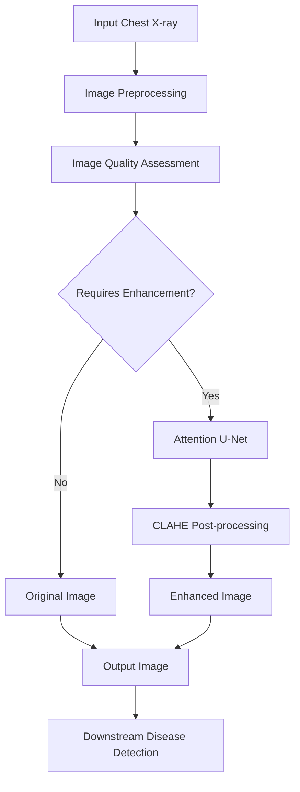
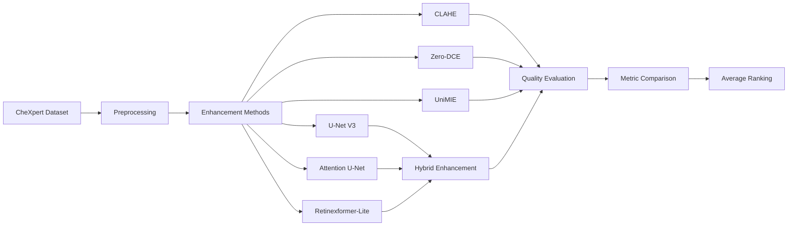
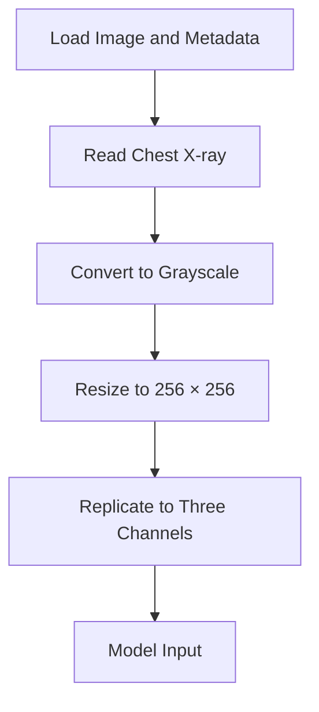
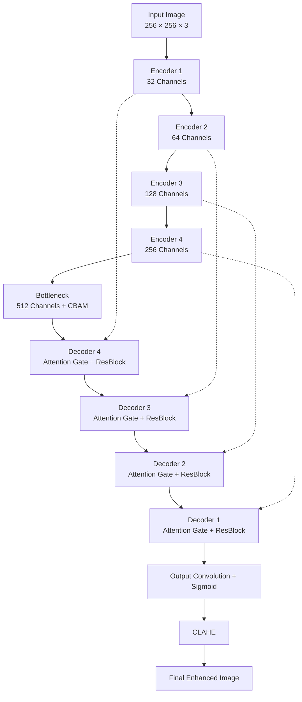
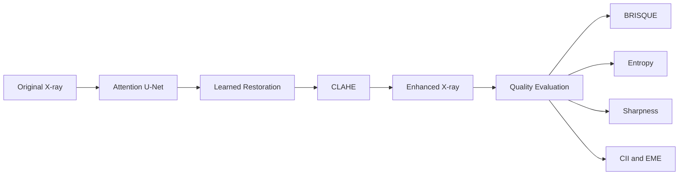
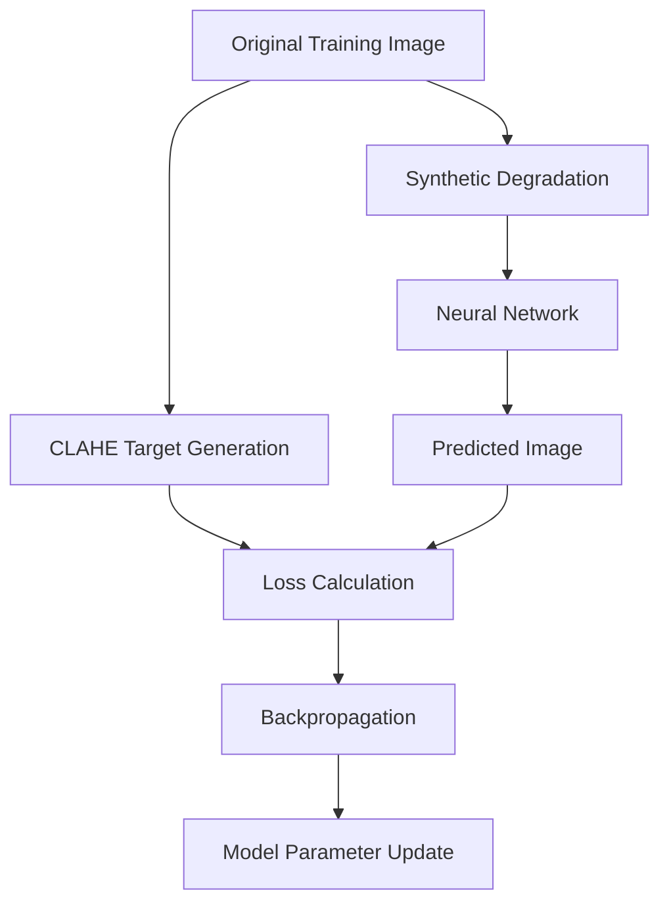
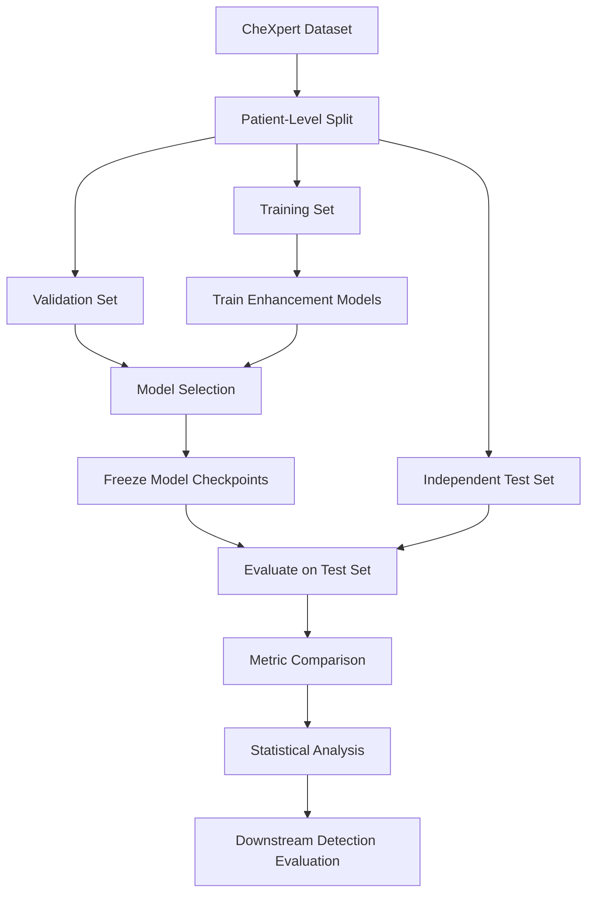

# ReXTrust — Chest X-ray Image Enhancement

### A Comparative Study of Classical, Deep Learning, Attention-Based, and Hybrid Enhancement Methods

**Project:** ReXTrust  
**Team:** VLIL Team 95  
**Institution:** Amrita Vishwa Vidyapeetham, Coimbatore  
**Domain:** Medical Image Processing · Deep Learning · Computer Vision

---

## 1. Abstract

Chest X-ray images are susceptible to low contrast, noise, and uneven illumination, which can affect the visibility of anatomical structures and the performance of downstream medical-image analysis systems. This project investigates image enhancement methods that aim to improve visual quality while minimizing the loss of diagnostically relevant information.

The proposed work compares classical image processing, unsupervised enhancement, diffusion-based methods, supervised neural networks, attention-based architectures, and hybrid enhancement pipelines using the CheXpert chest radiograph dataset.

The principal contribution is an **Attention U-Net + CLAHE hybrid pipeline** that combines learned image restoration with contrast-limited adaptive histogram equalization. The Attention U-Net incorporates residual blocks, a Convolutional Block Attention Module (CBAM), and attention-gated skip connections.

Performance is evaluated using BRISQUE, Shannon entropy, Laplacian-variance sharpness, Contrast Improvement Index (CII), and Enhancement Measure Evaluation (EME).

In the documented evaluation of 23 selected images, Attention U-Net + CLAHE achieved an average rank of **2.2 across eight methods**, a mean entropy of **7.92**, and a mean CII of **1.90**. These results are preliminary because of evaluation-subset selection and potential overlap between training and evaluation images. Independent, patient-level validation is required before drawing general conclusions.

---

## 2. Project Overview

### 2.1 Problem Statement

Chest X-ray images may exhibit poor contrast, noise, and uneven illumination. Classical enhancement methods can amplify noise, while deep-learning models may smooth fine structures or introduce artifacts.

The objective is to develop and evaluate enhancement techniques that balance:

- Contrast and visibility improvement.
- Noise reduction and structural preservation.
- Image sharpness and information content.
- Computational efficiency.
- Reliability of downstream medical-image analysis.

### 2.2 Project Objectives

1. Implement and compare multiple chest X-ray enhancement techniques.
2. Develop an attention-based U-Net architecture with residual blocks and CBAM.
3. Investigate hybrid pipelines combining neural restoration with CLAHE.
4. Evaluate enhanced images using complementary image-quality metrics.
5. Examine preservation of fine structures, including support-device edges.
6. Compare enhancement quality across a common experimental subset.
7. Identify potential data leakage and methodological limitations.

### 2.3 Research Questions

| ID | Research Question |
|---|---|
| RQ1 | Does combining neural restoration with CLAHE improve enhancement quality compared with either method alone? |
| RQ2 | Do attention mechanisms improve the performance of a conventional U-Net architecture? |
| RQ3 | How do classical, unsupervised, diffusion-based, and learned enhancement approaches compare? |
| RQ4 | Are fine image structures preserved after enhancement? |
| RQ5 | How reliable are the observed improvements under an independent evaluation protocol? |

---

## 3. System Architecture

The enhancement module is designed to operate as an image-quality assessment and enhancement stage within the broader ReXTrust pipeline.

### 3.1 Conditional Enhancement Workflow



The quality-assessment stage uses BRISQUE and entropy thresholds in the documented implementation. The decision thresholds are experimental and have not been clinically validated.

### 3.2 Enhancement Module Workflow



---

## 4. Dataset and Preprocessing

### 4.1 Dataset

The experiments use the **CheXpert chest radiograph dataset**, which contains chest X-ray images and associated radiology labels.

The notebooks load image metadata from `train.csv` and optionally reference `valid.csv`.

### 4.2 Dataset Configuration

```python
BASE_PATH = "/kaggle/input/datasets/ashery/chexpert"

TRAIN_CSV = f"{BASE_PATH}/train.csv"
VALID_CSV = f"{BASE_PATH}/valid.csv"
```

Update `BASE_PATH` according to the environment in which the notebooks are executed.

### 4.3 Preprocessing Pipeline



The documented preprocessing workflow converts images to grayscale, resizes them to 256 × 256 pixels, and replicates the grayscale channel for neural networks expecting three-channel inputs.

### 4.4 Experimental Subsets

| Subset | Number of Images | Purpose |
|---|---:|---|
| Initial random sample | 50 | Quality screening |
| Flagged low-quality subset | 23 | Multi-image evaluation |
| Single-image subset | 1 | Detailed ten-method comparison |
| Support-device example | 1 | Edge-preservation assessment |

The 23-image subset was selected using BRISQUE and entropy thresholds. Because these metrics are also used during evaluation, the selection procedure introduces potential bias.

### 4.5 Quality Screening

The notebook flags an image for enhancement when either condition is satisfied:

```text
BRISQUE > 5.0 OR Entropy < 7.95
```

These are experimental thresholds rather than clinically established criteria.

---

## 5. Enhancement Methods

| Method | Category | Description |
|---|---|---|
| Original | Reference | Unprocessed input image |
| CLAHE | Classical image processing | Local histogram equalization with contrast limiting |
| Zero-DCE | Unsupervised deep learning | Pixel-wise enhancement curve estimation |
| UniMIE | Diffusion-based enhancement | Diffusion-model-based image enhancement |
| U-Net V3 | Supervised deep learning | Encoder-decoder restoration network |
| U-Net V3 + CLAHE | Hybrid | Neural restoration followed by CLAHE |
| Attention U-Net | Attention-based deep learning | Residual blocks, CBAM, and attention gates |
| Attention U-Net + CLAHE | Proposed hybrid | Attention-based restoration followed by CLAHE |
| Retinexformer-Lite | Transformer-inspired | Illumination-guided feature processing |
| Retinexformer-Lite + CLAHE | Hybrid | Illumination-aware enhancement followed by CLAHE |

### 5.1 CLAHE

Contrast Limited Adaptive Histogram Equalization enhances local contrast by equalizing intensity distributions within image tiles while limiting excessive contrast amplification.

It is computationally efficient and does not require training. However, it may amplify noise or produce excessive local contrast.

### 5.2 Zero-DCE

Zero-DCE estimates pixel-wise enhancement curves using a lightweight convolutional neural network.

The implementation uses an unsupervised training approach with losses associated with spatial consistency, exposure control, color constancy, and illumination smoothness.

### 5.3 UniMIE

UniMIE is used for diffusion-based enhancement experiments with a pretrained diffusion checkpoint and the guided-diffusion implementation.

Generative enhancement can modify fine details, so its outputs require careful visual and quantitative assessment.

### 5.4 U-Net V3

U-Net V3 uses an encoder-decoder architecture with skip connections. It is trained to map synthetically degraded images to CLAHE-generated targets.

Its training objective combines L1 reconstruction loss, SSIM-based structural loss, and Laplacian edge loss.

Because the targets are generated using CLAHE, the network learns the characteristics of that target-generation procedure rather than a verified ideal clinical image.

### 5.5 Retinexformer-Lite

Retinexformer-Lite is a simplified Retinexformer-inspired architecture that uses illumination-guided multi-head self-attention.

An illumination estimator generates a light map that modulates feature processing. The implementation is an adaptation, not an exact reproduction of the original Retinexformer architecture.

---

## 6. Proposed Method: Attention U-Net + CLAHE

### 6.1 Methodology

The proposed hybrid approach combines learned restoration with classical contrast enhancement.

The Attention U-Net reconstructs image features using residual blocks, channel and spatial attention, and attention-gated skip connections. CLAHE is then applied to improve local contrast in the network output.

### 6.2 Detailed Architecture



### 6.3 Architecture Components

| Component | Role |
|---|---|
| Residual blocks | Learn feature corrections and support gradient propagation |
| Encoder | Extract hierarchical image features |
| CBAM | Apply channel and spatial attention at the bottleneck |
| Attention gates | Filter encoder features before skip-connection fusion |
| Decoder | Reconstruct higher-resolution image features |
| Output convolution | Produce the restored image |
| CLAHE | Enhance local contrast after neural restoration |

### 6.4 Model Specifications

| Parameter | Value |
|---|---|
| Input resolution | 256 × 256 |
| Input channels | 3 |
| Encoder stages | 4 |
| Bottleneck channels | 512 |
| Attention mechanism | CBAM and attention gates |
| Trainable parameters | 8,235,421 |
| Float32 model size | Approximately 31.42 MB |
| Post-processing | CLAHE |

### 6.5 Hybrid Processing Flow



The proposed design aims to combine learned feature reconstruction with controlled local contrast enhancement. Its effectiveness must be established through independent evaluation rather than assumed from the architecture alone.

---

## 7. Training Configuration

### 7.1 Synthetic Training Data

The supervised models use synthetically degraded images as inputs and CLAHE-generated images as targets.



The documented degradation configuration includes Gaussian noise and Gaussian blur.

### 7.2 Training Settings

| Setting | U-Net V3 | Attention U-Net | Retinexformer-Lite |
|---|---|---|---|
| Optimizer | Adam | Adam | Adam |
| Learning rate | 3 × 10⁻⁴ | 3 × 10⁻⁴ | 3 × 10⁻⁴ |
| Maximum epochs | 60 | 60 | 60 |
| Batch size | 8 | 8 | 8 |
| Training images | 1,900 | 400 | 1,799 |
| Validation images | 100 | 100 | 200 |
| Loss | L1 + SSIM + Laplacian | L1 + SSIM + Laplacian | Same + illumination smoothness |
| Scheduler | ReduceLROnPlateau | ReduceLROnPlateau | ReduceLROnPlateau |

The documented experiments used a Tesla T4 GPU. Training settings and data splits should be verified against the notebook before reproducing results.

---

## 8. Evaluation Metrics

The project uses five complementary metrics because enhancement quality cannot be characterized reliably by a single numerical measure.

| Metric | Preferred Direction | Purpose |
|---|---|---|
| BRISQUE | Lower | Estimates perceptual image quality |
| Shannon entropy | Higher, with caution | Measures image intensity information content |
| Sharpness | Higher, with caution | Measures high-frequency image detail |
| CII | Higher | Measures contrast improvement relative to the original |
| EME | Higher, with caution | Evaluates local contrast characteristics |

### 8.1 BRISQUE

BRISQUE is a no-reference perceptual quality metric. Its interpretation on chest X-rays is limited because it is based on natural-image statistics.

### 8.2 Shannon Entropy

Entropy measures the information content of the image intensity distribution. Higher entropy does not necessarily indicate better quality because noise can also increase entropy.

### 8.3 Sharpness

Sharpness is estimated using the variance of the Laplacian. Higher values may reflect stronger edges but can also result from noise or excessive sharpening.

### 8.4 Contrast Improvement Index

CII compares image contrast with that of the original image. The original image is assigned a CII of 1.00 by construction.

### 8.5 Enhancement Measure Evaluation

EME measures local contrast characteristics across image blocks. A higher value alone does not guarantee anatomical preservation.

### 8.6 Average Ranking

Methods are ranked separately for each metric, respecting its preferred direction. The ranks are then aggregated.

A lower average rank indicates better overall ranking across the selected metrics, not necessarily better clinical performance.

---

## 9. Experimental Results

### 9.1 Multi-Image Evaluation

The following table reports the documented results for 23 selected images across eight methods.

| Rank | Method | BRISQUE ↓ | Entropy ↑ | Sharpness ↑ | CII ↑ | EME ↑ | Average Rank |
|---:|---|---:|---:|---:|---:|---:|---:|
| 1 | **Attention U-Net + CLAHE** | 13.35 | **7.92** | 2082.26 | **1.90** | 11.10 | **2.2** |
| 2 | U-Net V3 + CLAHE | 17.51 | 7.91 | 1859.65 | 1.76 | 10.76 | 3.2 |
| 3 | CLAHE | 7.01 | 7.84 | **3609.61** | 1.71 | 8.65 | 3.8 |
| 4 | Attention U-Net | 13.22 | 7.86 | 1295.71 | 1.37 | 7.90 | 4.6 |
| 5 | Original | 5.62 | 7.85 | 534.33 | 1.00 | 9.54 | 5.2 |
| 6 | Zero-DCE | 19.59 | 6.54 | 1766.44 | 1.27 | **12.16** | 5.4 |
| 7 | U-Net V3 | 17.96 | 7.86 | 1190.87 | 1.29 | 7.71 | 5.6 |
| 8 | UniMIE | -0.81 | 7.85 | 725.65 | 0.93 | 5.44 | 6.0 |

Retinexformer-Lite and Retinexformer-Lite + CLAHE were evaluated separately in the documented single-image comparison.

### 9.2 Key Findings

- Attention U-Net + CLAHE achieved the best average rank of **2.2**.
- The proposed method achieved the highest mean entropy and CII in this evaluation.
- CLAHE achieved the highest sharpness value, but sharpness can increase through noise amplification.
- Zero-DCE achieved the highest EME value but the lowest entropy.
- UniMIE achieved the lowest BRISQUE value, while its CII was below 1.0.
- No method performed best on every metric.

### 9.3 Single-Image Comparison

The following results correspond to the documented image `view2_lateral.jpg`.

| Rank | Method | BRISQUE ↓ | Entropy ↑ | Sharpness ↑ | CII ↑ | EME ↑ | Average Rank |
|---:|---|---:|---:|---:|---:|---:|---:|
| 1 | **Attention U-Net + CLAHE** | 1.50 | 7.37 | 1621.70 | 1.79 | 8.46 | 1.8 |
| 2 | U-Net V3 + CLAHE | 22.89 | 7.29 | 821.18 | 1.37 | 7.57 | 4.4 |
| 3 | Retinexformer-Lite + CLAHE | 21.62 | 7.33 | 593.43 | 1.39 | 7.55 | 4.4 |
| 4 | CLAHE | 6.72 | 6.85 | 2212.86 | 1.28 | 5.73 | 4.8 |
| 5 | Zero-DCE | 14.74 | 5.43 | 876.06 | 1.16 | 21.41 | 5.0 |
| 6 | Attention U-Net | 8.50 | 7.05 | 777.61 | 1.24 | 5.98 | 5.2 |
| 7 | U-Net V3 | 33.58 | 7.12 | 491.36 | 1.07 | 6.23 | 6.8 |
| 8 | UniMIE | 1.01 | 7.00 | 366.94 | 0.88 | 4.34 | 7.0 |
| 9 | Original | 19.22 | 6.79 | 285.95 | 1.00 | 18.38 | 7.2 |
| 10 | Retinexformer-Lite | 28.28 | 6.93 | 297.79 | 1.01 | 5.66 | 8.4 |

Single-image results are illustrative and cannot establish general superiority.

### 9.4 Edge Preservation

| Method | Fine-Edge Retention |
|---|---:|
| CLAHE | 98.6% |
| Attention U-Net | 99.1% |
| Attention U-Net + CLAHE | 98.9% |

This assessment uses a single support-device image and a Canny edge comparison. It measures retained edges but does not fully capture newly introduced edges or semantic preservation.

### 9.5 Statistical Comparison

The notebook reports a paired Wilcoxon signed-rank test comparing Attention U-Net + CLAHE with U-Net V3 + CLAHE over 23 image pairs.

| Metric | Reported p-value |
|---|---:|
| BRISQUE | 0.0003 |
| Entropy | 0.0001 |
| Sharpness | 0.0049 |
| CII | < 0.0001 |
| EME | 0.0001 |

These values are uncorrected for multiple comparisons and are affected by the evaluation protocol. They should not be interpreted as evidence of clinical benefit.

---

## 10. Limitations and Data Leakage Audit

### 10.1 Potential Training-Evaluation Overlap

| Model | Documented Status |
|---|---|
| U-Net V3 | 18 of 23 evaluation images overlap with its training pool |
| Attention U-Net | Potential overlap with all 23 evaluation images |
| Retinexformer-Lite | Notebook includes a leakage guard |
| Zero-DCE | Image overlap has not been fully verified |
| CLAHE | No training-related leakage |
| UniMIE | Uses a pretrained diffusion model |

The Attention U-Net training pool and evaluation subset were generated through related sampling procedures using the same random seed. Consequently, evaluation images may have been included in training or validation.

The overlap should be independently verified from the actual image-path lists. Patient-level separation is also required because different images from the same patient may appear in multiple subsets.

### 10.2 Additional Limitations

- Small evaluation subset.
- Selection of evaluation images using metrics later used for assessment.
- No clinically ideal reference images.
- Limited suitability of BRISQUE for medical radiographs.
- Sharpness and entropy can increase because of noise.
- Supervised models learn from CLAHE-generated targets.
- Single-image artifact-preservation evaluation.
- Uncorrected statistical comparisons.
- Incomplete multi-image comparison of all ten configurations.
- No established improvement in downstream disease-detection accuracy.

### 10.3 Recommended Validation Protocol



A robust evaluation should:

1. Split data at the patient level before training.
2. Exclude all test patients from training and validation.
3. Select test images independently of evaluation metrics.
4. Compare every method on the same fixed test set.
5. Report uncertainty and correct for multiple statistical comparisons.
6. Evaluate the impact of enhancement on downstream disease detection.
7. Obtain expert assessment before making clinical claims.

---

## 11. Repository Structure

```text
Image_enhancement/
|
|-- results/
|   |-- artifact_highlighted_full.png
|   |-- comparision_table (2).png
|   |-- five_way_comparison_v3.png
|   |-- four_way_comparison_clean.png
|   |-- multi_image_eval_barchart.png
|   |-- quality_distribution.png
|   |-- single_image_comparison.png
|   |-- texture_blurring_verification.png
|   |-- unet_xray_v3.pt
|   |-- zerodce_training_loss.png
|   |-- zerodce_xray.pt
|
|-- README.md
|-- final_image_enhacement_3000.ipynb
|-- final-image-enhancement-with-attention.ipynb
|-- final-image-enhancement.ipynb
|-- final_image_enhancement_23_images.ipynb
|-- image_enhancement_stage_1.ipynb
|-- image_enhancement_unimie.ipynb
|-- unet_xray_v3.pt
|-- zerodce_xray.pt
```

### Key Files

| File | Description |
|---|---|
| `final_image_enhacement_3000.ipynb` | Consolidated enhancement and evaluation experiments |
| `final-image-enhancement-with-attention.ipynb` | Attention-based enhancement experiments |
| `final-image-enhancement.ipynb` | Image enhancement pipeline |
| `final_image_enhancement_23_images.ipynb` | Multi-image comparison and artifact assessment |
| `image_enhancement_stage_1.ipynb` | Initial enhancement workflow |
| `image_enhancement_unimie.ipynb` | Diffusion-based enhancement |
| `unet_xray_v3.pt` | U-Net V3 model checkpoint |
| `zerodce_xray.pt` | Zero-DCE model checkpoint |
| `results/` | Saved evaluation outputs and model assets |

The tree reflects the documented repository layout. File names should be updated if the repository changes.

---

## 12. Installation

### 12.1 Prerequisites

- Python 3.10 or a compatible version.
- Access to the CheXpert dataset.
- Jupyter Notebook or Kaggle Notebooks.
- CUDA-capable GPU recommended for training and diffusion inference.

### 12.2 Clone the Repository

```bash
git clone https://github.com/SuryaSampreeth/VLIL-Team-95.git
cd VLIL-Team-95/Image_enhancement
```

### 12.3 Create a Virtual Environment

**Windows PowerShell**

```powershell
python -m venv .venv
.venv\Scripts\Activate.ps1
```

**Linux / macOS**

```bash
python3 -m venv .venv
source .venv/bin/activate
```

### 12.4 Install Dependencies

```bash
python -m pip install --upgrade pip

python -m pip install numpy pandas scipy scikit-image scikit-learn matplotlib seaborn opencv-python-headless Pillow tqdm brisque piq jupyter
```

Install PyTorch and Torchvision using the official installation guide:

https://pytorch.org/get-started/locally/

The UniMIE experiments may require additional guided-diffusion dependencies and a separately obtained pretrained checkpoint.

The repository does not include a verified, fully pinned dependency lockfile. Package versions may need adjustment to match the Python, PyTorch, and CUDA environment.

### 12.5 Configure Dataset Path

Update `BASE_PATH` in the notebook to point to the CheXpert dataset.

Ensure that the paths in the metadata resolve correctly within the selected dataset directory.

---

## 13. Execution

1. Clone the repository.
2. Install the required dependencies.
3. Open `final_image_enhacement_3000.ipynb` in Kaggle or Jupyter Notebook.
4. Attach the CheXpert dataset and configure `BASE_PATH`.
5. Run setup and preprocessing cells.
6. Execute the enhancement methods and load checkpoints where applicable.
7. Run the evaluation cells to calculate image-quality metrics.
8. Review the comparative rankings and data-leakage checks.

Execute notebook cells in sequence because later stages may depend on variables, functions, and models defined earlier.

The documented multi-image comparison takes approximately 15 minutes on a Tesla T4 GPU, largely because of UniMIE inference. Actual runtime varies with the environment.

---

## 14. Reproducibility

| Configuration | Documented Value |
|---|---|
| Training seed | 42 |
| Evaluation seed | 123 |
| Sampling seed | 42 |
| Image resolution | 256 × 256 |
| Batch size | 8 for supervised models |
| GPU | Tesla T4, approximately 15.6 GB |
| PyTorch | 2.10.0+cu128 |
| NumPy | 2.4.6 |

For reproducible experiments, record the dataset version, patient split, checkpoint, model configuration, package versions, and evaluation protocol.

Random seeds improve repeatability but do not guarantee identical outputs across different hardware and library versions.

---

## 15. Future Work

- Re-evaluate all learned models using a fixed, patient-level, leakage-free test set.
- Expand evaluation across frontal and lateral radiographs.
- Investigate the effect of enhancement on downstream disease-detection performance.
- Conduct expert assessment of image quality and structural preservation.
- Investigate medical-domain image-quality metrics.
- Improve automated quality assessment beyond fixed thresholds.
- Evaluate robustness across acquisition settings and patient populations.
- Integrate the enhancement module into the complete ReXTrust pipeline.
- Add pinned dependencies and experiment tracking for reproducible research.

---

## 16. Responsible Use

This project is intended for **research and educational purposes only**.

Enhanced images may contain artifacts or altered details. They must not replace original radiographs or professional clinical interpretation.

The reported experiments do not establish clinical safety, diagnostic accuracy, or regulatory approval. Any clinical application requires independent validation, appropriate clinical oversight, and compliance with applicable regulations.

Use the CheXpert dataset in accordance with its access and usage terms. Do not commit patient-identifying information, credentials, or access tokens to the repository.

---

## 17. Team and Acknowledgements

**Team:** VLIL Team 95  
**Institution:** Amrita Vishwa Vidyapeetham, Department of Computer Science and Engineering

This project builds on research in medical-image processing, convolutional neural networks, attention mechanisms, diffusion models, and image-quality assessment.

We acknowledge the CheXpert dataset contributors and the open-source communities behind PyTorch, OpenCV, scikit-image, PIQ, and guided-diffusion.

---

## 18. References

1. Irvin, J. et al. "CheXpert: A Large Chest Radiograph Dataset with Uncertainty Labels and Expert Comparison." AAAI, 2019.
2. Zuiderveld, K. "Contrast Limited Adaptive Histogram Equalization." *Graphics Gems IV*, 1994.
3. Guo, C. et al. "Zero-Reference Deep Curve Estimation for Low-Light Image Enhancement." CVPR, 2020.
4. Ronneberger, O., Fischer, P., and Brox, T. "U-Net: Convolutional Networks for Biomedical Image Segmentation." MICCAI, 2015.
5. Oktay, O. et al. "Attention U-Net: Learning Where to Look for the Pancreas." MIDL, 2018.
6. Woo, S. et al. "CBAM: Convolutional Block Attention Module." ECCV, 2018.
7. He, K. et al. "Deep Residual Learning for Image Recognition." CVPR, 2016.
8. Cai, Y. et al. "Retinexformer: One-stage Retinex-based Transformer for Low-light Image Enhancement." ICCV, 2023.
9. Dhariwal, P. and Nichol, A. "Diffusion Models Beat GANs on Image Synthesis." NeurIPS, 2021.
10. Mittal, A., Moorthy, A. K., and Bovik, A. C. "No-Reference Image Quality Assessment in the Spatial Domain." IEEE Transactions on Image Processing, 2012.
11. Wang, Z. et al. "Image Quality Assessment: From Error Visibility to Structural Similarity." IEEE Transactions on Image Processing, 2004.
12. Agaian, S. S., Panetta, K., and Grigoryan, A. M. "Transform-Based Image Enhancement Algorithms with Performance Measure." IEEE Transactions on Image Processing, 2001.
13. Wilcoxon, F. "Individual Comparisons by Ranking Methods." Biometrics Bulletin, 1945.
14. UniMIE implementation: https://github.com/Fayeben/UniMIE

---

**ReXTrust | Chest X-ray Image Enhancement**

*Research and educational use only.*
