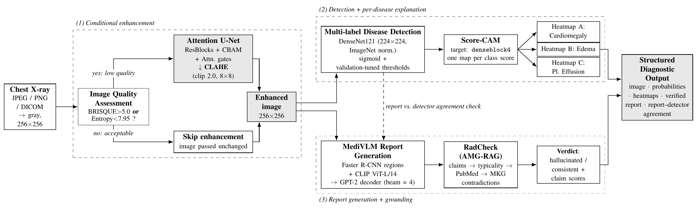
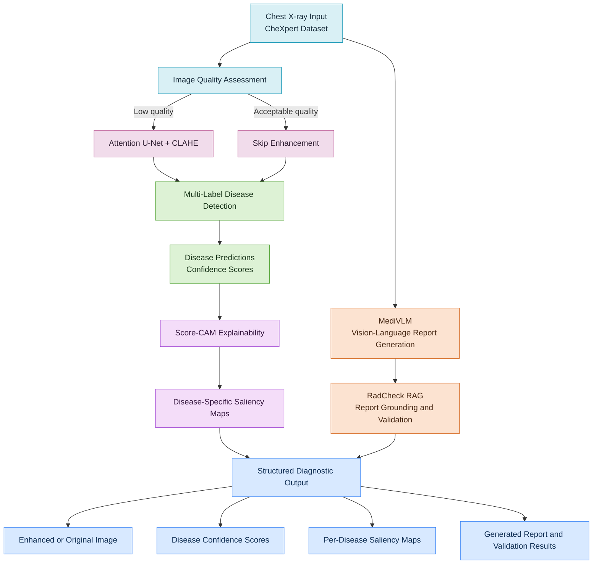
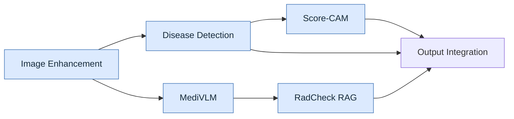
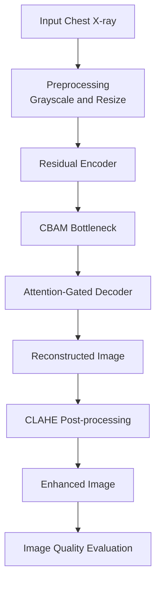
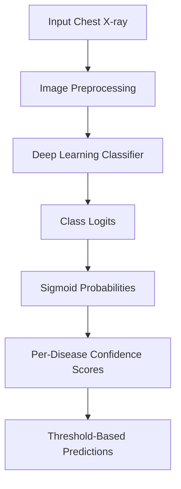
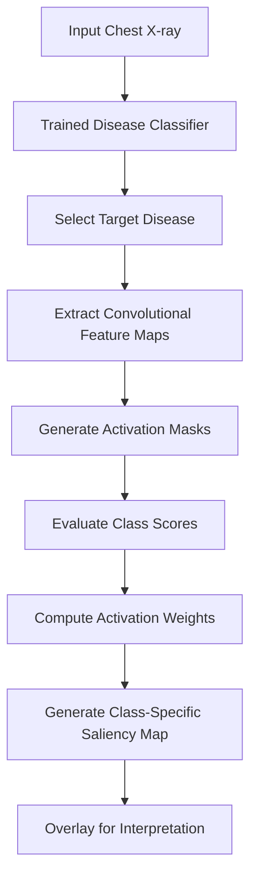
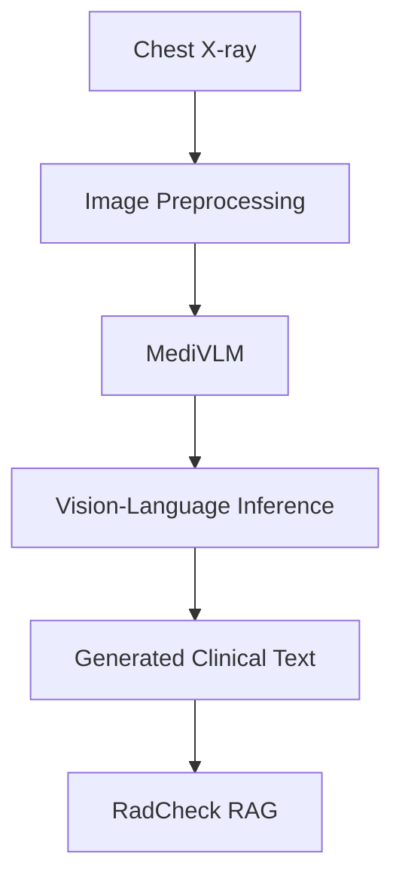
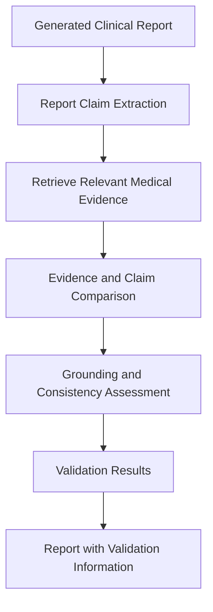
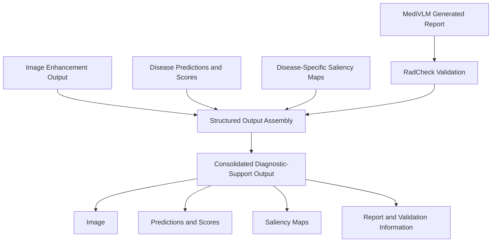
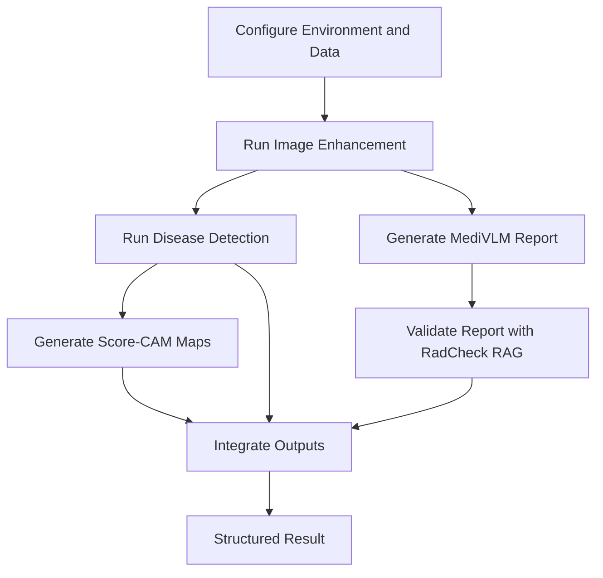

# ReXTrust: An Explainable AI Pipeline for Chest X-ray Analysis

### Integrating Image Enhancement, Multi-Label Disease Detection, Visual Explainability, Vision-Language Models, and RAG-Based Report Validation

**Project:** ReXTrust  
**Team:** VLIL Team 95  
**Institution:** Amrita Vishwa Vidyapeetham, Coimbatore  
**Domain:** Medical Imaging · Deep Learning · Explainable AI · Retrieval-Augmented Generation

---

## Abstract

Chest X-ray interpretation is an important component of thoracic disease assessment. However, variations in image quality, the complexity of disease classification, limited model interpretability, and the possibility of unsupported statements in generated reports present challenges for automated medical-image analysis.

**ReXTrust** is an integrated research pipeline designed to investigate these challenges through a modular combination of image enhancement, multi-label disease detection, disease-specific visual explanations, vision-language report generation, and retrieval-augmented report validation.

The pipeline incorporates an Attention U-Net + Contrast Limited Adaptive Histogram Equalization (CLAHE) approach for conditional image enhancement, a deep-learning classifier for predicting thoracic findings, Score-CAM for disease-specific saliency maps, MediVLM for vision-language report generation, and RadCheck RAG for evidence-grounded report verification.

The objective is to produce a structured output that combines an enhanced or unchanged radiograph, disease confidence scores, per-disease saliency maps, and a report accompanied by validation information.

ReXTrust is intended for research and educational purposes. Its integration into a single pipeline does not establish clinical validity, diagnostic reliability, or readiness for clinical deployment. These require independent evaluation and appropriate clinical oversight.

---

## Table of Contents

1. [Project Overview](#1-project-overview)
2. [Problem Statement](#2-problem-statement)
3. [Objectives](#3-objectives)
4. [System Architecture](#4-system-architecture)
5. [Pipeline Components](#5-pipeline-components)
6. [Image Enhancement](#6-image-enhancement)
7. [Disease Detection](#7-disease-detection)
8. [Explainability with Score-CAM](#8-explainability-with-score-cam)
9. [Vision-Language Report Generation](#9-vision-language-report-generation)
10. [RadCheck RAG Report Validation](#10-radcheck-rag-report-validation)
11. [Structured Diagnostic Output](#11-structured-diagnostic-output)
12. [Repository Structure](#12-repository-structure)
13. [Technology Stack](#13-technology-stack)
14. [Installation and Setup](#14-installation-and-setup)
15. [Execution Workflow](#15-execution-workflow)
16. [Evaluation Strategy](#16-evaluation-strategy)
17. [Limitations](#17-limitations)
18. [Future Work](#18-future-work)
19. [Responsible Use](#19-responsible-use)
20. [Acknowledgements](#20-acknowledgements)
21. [References](#21-references)

---

## 1. Project Overview

ReXTrust is a modular chest X-ray analysis pipeline that brings together complementary techniques from medical image processing, deep learning, explainable AI, vision-language modelling, and retrieval-augmented generation.

Instead of treating disease classification as an isolated prediction task, the system is designed to provide several forms of supporting information:

- An enhanced image when the input quality assessment indicates that enhancement is needed.
- Multi-label disease predictions and associated confidence scores.
- A separate visual saliency map for each predicted disease.
- Vision-language-generated clinical text.
- Evidence-grounding and report-validation information.
- A consolidated structured output.

### Key Features

- **Conditional image enhancement:** Avoids applying enhancement indiscriminately to every input.
- **Multi-label disease detection:** Supports predictions for multiple thoracic findings.
- **Disease-specific explainability:** Generates separate Score-CAM maps for individual predicted classes.
- **Vision-language integration:** Uses MediVLM for clinical text generation.
- **Evidence-grounded validation:** Uses RadCheck RAG to assess generated report claims.
- **Modular architecture:** Separates individual components to support development and evaluation.

---

## 2. Problem Statement

Automated chest X-ray analysis involves several interconnected challenges.

1. **Image quality:** Low contrast and uneven illumination can affect image visibility.
2. **Disease classification:** A single radiograph may contain multiple findings, requiring multi-label prediction.
3. **Interpretability:** Confidence scores alone do not explain which image regions influenced a prediction.
4. **Report generation:** Generated clinical text may contain unsupported or inconsistent statements.
5. **Evidence grounding:** Generated reports require mechanisms to compare their claims with relevant medical evidence.
6. **Integration:** Predictions, explanations, and reports must be brought together in a coherent output.

ReXTrust investigates a modular approach to these challenges by combining image processing, predictive modelling, visual explanation, and report validation.

---

## 3. Objectives

The major objectives of the project are:

1. Develop a conditional chest X-ray enhancement workflow.
2. Investigate Attention U-Net + CLAHE for image restoration and local contrast enhancement.
3. Implement multi-label classification of selected thoracic findings.
4. Generate disease-specific explanations using Score-CAM.
5. Integrate a vision-language model for report generation.
6. Implement retrieval-augmented report grounding and validation.
7. Consolidate the outputs into a structured diagnostic-support format.
8. Evaluate individual components using appropriate quantitative and qualitative methods.
9. Investigate limitations related to data leakage, prediction uncertainty, and generated-report reliability.

---

## 4. System Architecture

ReXTrust follows a modular architecture in which image enhancement, disease detection, explainability, and report generation perform separate responsibilities before their outputs are consolidated.

### 4.1 Overall Architecture

The following architecture diagram illustrates the intended interaction between the major system components.



*Figure 1. Overall ReXTrust architecture showing conditional image enhancement, multi-label disease detection, Score-CAM explainability, MediVLM report generation, RadCheck RAG validation, and structured diagnostic output.*

**Image location:** `rextrust_architecture.png` in the repository root.

### 4.2 End-to-End Processing Workflow



### 4.3 Data Flow

| Stage | Input | Processing | Output |
|---|---|---|---|
| 1. Image input | Chest X-ray | Image loading and preprocessing | Model-ready image |
| 2. Quality assessment | Input image | Quality screening | Enhancement decision |
| 3. Enhancement | Low-quality image | Attention U-Net + CLAHE | Enhanced image |
| 4. Disease detection | Enhanced or original image | Multi-label classifier | Class confidence scores |
| 5. Explainability | Image and classifier | Score-CAM | Class-specific saliency maps |
| 6. Report generation | Chest X-ray | MediVLM | Generated clinical text |
| 7. Report validation | Generated report and retrieved evidence | RadCheck RAG | Grounding and validation information |
| 8. Output consolidation | Module outputs | Structured result assembly | Consolidated diagnostic-support output |

The diagram describes the intended processing flow. Exact runtime dependencies and integration behaviour depend on the current implementation of each module.

---

## 5. Pipeline Components

| Component | Repository Directory | Responsibility |
|---|---|---|
| Image Enhancement | `Image_enhancement/` | Conditional image restoration and contrast enhancement |
| Disease Detection | `DiseaseDetection/` | Multi-label thoracic disease classification |
| Score-CAM | `ScoreCAM/` | Class-specific visual explanations |
| MediVLM | `MediVLM/` | Vision-language report generation |
| RadCheck RAG | `RadCheck RAG/` | Evidence-grounded report validation |
| Complete Pipeline | `Complete Pipeline/` | Application integration and orchestration |

### 5.1 Module Interaction



The enhancement and detection modules support the visual analysis workflow, while MediVLM and RadCheck RAG support report generation and verification. The Complete Pipeline module coordinates the components where integration is implemented.

---

## 6. Image Enhancement

The image enhancement module investigates classical, unsupervised, diffusion-based, supervised, attention-based, and hybrid techniques for improving chest X-ray image quality.

### 6.1 Evaluated Methods

| Method | Category | Purpose |
|---|---|---|
| CLAHE | Classical image processing | Improves local contrast |
| Zero-DCE | Unsupervised deep learning | Estimates pixel-wise enhancement curves |
| UniMIE | Diffusion-based enhancement | Investigates generative image enhancement |
| U-Net V3 | Supervised deep learning | Learns image restoration from synthetic degradation |
| U-Net V3 + CLAHE | Hybrid | Combines learned restoration with contrast enhancement |
| Attention U-Net | Attention-based deep learning | Uses attention mechanisms during reconstruction |
| Attention U-Net + CLAHE | Proposed hybrid | Combines attention-based restoration with CLAHE |
| Retinexformer-Lite | Transformer-inspired | Uses illumination-guided feature processing |
| Retinexformer-Lite + CLAHE | Hybrid | Adds local contrast enhancement after restoration |

### 6.2 Proposed Attention U-Net + CLAHE

The proposed enhancement method combines an attention-based encoder-decoder network with CLAHE post-processing.

The architecture incorporates:

- Residual blocks for feature extraction and reconstruction.
- CBAM for channel and spatial attention.
- Attention gates for filtering encoder skip-connection features.
- A decoder for reconstructing the enhanced image.
- CLAHE for local contrast enhancement.

#### Enhancement Workflow



### 6.3 Image Quality Assessment

The enhancement experiments use complementary metrics:

| Metric | Interpretation |
|---|---|
| BRISQUE | No-reference perceptual quality estimate; lower is conventionally better |
| Shannon Entropy | Intensity information content; higher does not necessarily mean better quality |
| Sharpness | High-frequency detail estimate; can increase because of noise |
| CII | Contrast improvement relative to the original |
| EME | Local contrast assessment |
| Average Rank | Aggregate ranking across selected metrics |

### 6.4 Reported Results

In the documented evaluation of 23 selected images, Attention U-Net + CLAHE achieved an average rank of 2.2 across eight methods, a mean entropy of 7.92, and a mean CII of 1.90.

These results are preliminary. The selected evaluation subset and potential overlap with training images limit the strength of the conclusions.

Further details, model implementations, and experimental results are documented in [`Image_enhancement/`](Image_enhancement/).

---

## 7. Disease Detection

The disease detection module investigates multi-label classification of chest X-ray images.

Unlike single-label classification, multi-label prediction allows a single radiograph to receive positive predictions for multiple findings.

### 7.1 Target Findings

The documented Stage 2 experiments focus on:

- Cardiomegaly
- Edema
- Pleural Effusion

### 7.2 Classification Workflow



The classifier produces a confidence score for each target finding. Thresholds convert the scores into binary predictions.

The confidence scores are model outputs and should not automatically be interpreted as calibrated probabilities of disease.

### 7.3 Model Development

The repository includes DenseNet121-based experiments and additional architectures, including CNN-Transformer and graph-based label reasoning approaches.

The experiments investigate the effects of feature extraction, spatial relationships, label relationships, and training configurations on multi-label classification performance.

The exact model configuration and reported metrics should be taken from the corresponding final notebook in `DiseaseDetection/`.

### 7.4 Evaluation

The disease detection experiments use metrics such as:

- Precision
- Recall / Sensitivity
- F1 Score
- ROC-AUC
- Confusion Matrix
- Bootstrap Confidence Intervals

Patient-level separation between training, validation, and test partitions is essential to reduce leakage caused by multiple images from the same patient.

Further details are documented in [`DiseaseDetection/`](DiseaseDetection/).

---

## 8. Explainability with Score-CAM

Score-CAM is used to investigate which spatial regions contribute to a selected class prediction.

The method generates class-specific activation maps by evaluating the model's responses to feature-map-derived activation masks.

### 8.1 Processing Workflow



### 8.2 Disease-Specific Explanations

For a multi-label prediction, separate saliency maps can be generated for individual predicted findings.

For example:

| Output | Explanation |
|---|---|
| Disease Class 1 | Saliency map for the first selected class |
| Disease Class 2 | Saliency map for the second selected class |
| Disease Class 3 | Saliency map for the third selected class |

The actual disease label associated with each map depends on the classifier's output classes.

### 8.3 Interpretation

Score-CAM maps provide visual information about regions associated with a model prediction. They do not prove that the model uses medically valid reasoning, and highlighted regions should not be interpreted as definitive lesion segmentation.

Further implementation details are documented in [`ScoreCAM/`](ScoreCAM/).

---

## 9. Vision-Language Report Generation

The MediVLM module investigates vision-language-based clinical text generation from chest X-ray inputs.

The module is intended to connect image-level information with natural-language descriptions that can be passed to the report-validation stage.

### 9.1 Processing Workflow



### 9.2 Role in ReXTrust

MediVLM is responsible for generating text from visual input. RadCheck RAG performs the subsequent report-grounding and validation stage.

Keeping these responsibilities separate allows the generated report to be evaluated independently of the mechanism used to validate its claims.

### 9.3 Important Considerations

Generated reports may omit findings, introduce unsupported statements, or misrepresent image content. A generated report must therefore not be treated as clinically verified merely because a vision-language model produced it.

Implementation and setup details are maintained in [`MediVLM/`](MediVLM/).

---

## 10. RadCheck RAG Report Validation

RadCheck RAG investigates the use of retrieval-augmented generation and evidence-grounding techniques to assess generated clinical reports.

The objective is to compare report claims with retrieved medical information and identify statements that may require further verification.

### 10.1 Validation Workflow



### 10.2 Responsibilities

- Process generated report text.
- Retrieve relevant supporting information from the configured knowledge source.
- Assess whether report claims are supported by the retrieved evidence.
- Identify claims that require further review.
- Produce validation information for downstream output integration.

### 10.3 Limitations

Retrieval-augmented validation cannot guarantee that a report is factually correct or clinically complete. Results depend on the knowledge source, retrieval quality, claim extraction, and validation logic.

The RadCheck module is documented in [`RadCheck RAG/`](RadCheck%20RAG/).

---

## 11. Structured Diagnostic Output

The final stage consolidates the outputs produced by the individual modules.

### 11.1 Output Components

| Component | Description |
|---|---|
| Input / Enhanced Image | Original radiograph or its enhanced version |
| Disease Predictions | Predicted target classes |
| Confidence Scores | Model-generated scores for individual diseases |
| Saliency Maps | Disease-specific Score-CAM explanations |
| Generated Report | Clinical text produced by MediVLM |
| Validation Information | Report-grounding and consistency results from RadCheck RAG |

### 11.2 Output Assembly



The structured output is intended to improve traceability by presenting predictions alongside visual explanations and report-validation information.

It is a research output, not an autonomous clinical diagnosis.

---

## 12. Repository Structure

The repository is organized into modules corresponding to the major components of ReXTrust.

```text
VLIL-Team-95/
│
├── Complete Pipeline/
│   └── Application integration and end-to-end workflow
│
├── DiseaseDetection/
│   ├── Models/
│   ├── dataset-loading.ipynb
│   ├── diseasedetectiondensenet121.ipynb
│   └── ReXTrust Stage 2 experiment notebooks
│
├── Image_enhancement/
│   ├── results/
│   ├── final-image-enhancement-with-attention.ipynb
│   ├── final-image-enhancement.ipynb
│   ├── final_image_enhancement_23_images.ipynb
│   ├── image_enhancement_stage_1.ipynb
│   ├── image_enhancement_unimie.ipynb
│   ├── unet_xray_v3.pt
│   └── zerodce_xray.pt
│
├── MediVLM/
│   └── Vision-language model implementation and setup
│
├── RadCheck RAG/
│   └── Retrieval, report grounding, and validation
│
├── ScoreCAM/
│   └── Score-CAM explainability implementation
│
├── rextrust_architecture.png
└── README.md
```

*Note: The directory descriptions are high-level summaries. Verify exact filenames and subdirectories against the current repository before treating this tree as exhaustive.*

### Module Summary

| Directory | Purpose |
|---|---|
| `Complete Pipeline/` | Main application and integration workflow |
| `DiseaseDetection/` | Multi-label disease classification |
| `Image_enhancement/` | Chest X-ray enhancement methods |
| `MediVLM/` | Vision-language report generation |
| `RadCheck RAG/` | Report grounding and validation |
| `ScoreCAM/` | Disease-specific visual explainability |
| `rextrust_architecture.png` | Overall system architecture diagram |
| `README.md` | Project overview and documentation |

---

## 13. Technology Stack

The project uses the following technologies across its modules. Exact dependencies vary by component.

| Technology | Purpose |
|---|---|
| Python | Primary implementation language |
| PyTorch | Deep-learning model development and inference |
| Torchvision | Image transformations and pretrained models |
| OpenCV | Image processing and enhancement |
| NumPy | Numerical operations |
| pandas | Metadata and tabular data processing |
| scikit-learn | Evaluation metrics and classification analysis |
| scikit-image | Image-quality assessment |
| Matplotlib | Experimental visualization and analysis |
| Jupyter Notebook | Model experimentation |
| Vision-Language Models | Image-to-text generation |
| Retrieval-Augmented Generation | Evidence retrieval and report validation |

The installation requirements for each module should be followed separately because the complete pipeline may require different package versions or hardware configurations.

---

## 14. Installation and Setup

### 14.1 Prerequisites

- Python version compatible with the selected module dependencies.
- Access to the required dataset and pretrained checkpoints.
- Git.
- Jupyter Notebook or the execution environment specified by each module.
- A CUDA-capable GPU for training or GPU-dependent inference, where required.

### 14.2 Clone the Repository

```bash
git clone https://github.com/SuryaSampreeth/VLIL-Team-95.git
cd VLIL-Team-95
```

### 14.3 Create a Virtual Environment

**Windows PowerShell**

```powershell
python -m venv .venv
.venv\Scripts\Activate.ps1
```

**Linux / macOS**

```bash
python3 -m venv .venv
source .venv/bin/activate
```

### 14.4 Install Module Dependencies

Install the dependencies required by the module you intend to execute.

For example, the image-enhancement experiments use packages such as:

```bash
python -m pip install numpy pandas scipy scikit-image scikit-learn matplotlib opencv-python-headless Pillow tqdm jupyter
```

Install PyTorch and Torchvision using the official installation selector:

https://pytorch.org/get-started/locally/

Other modules may require additional packages, model checkpoints, retrieval databases, or model-specific configuration. Consult the README and dependency files inside each module before running it.

**Note:** The root-level installation command is not a substitute for the individual modules' requirements. Do not assume that one Python environment will satisfy every dependency without version conflicts.

---

## 15. Execution Workflow

The exact commands depend on the current implementation of each module. The recommended high-level execution sequence is:

1. Configure the dataset and model paths.
2. Run the image-quality assessment and enhancement workflow.
3. Run multi-label disease detection on the selected image.
4. Generate Score-CAM maps for the target disease classes.
5. Generate the vision-language report using MediVLM.
6. Pass the report to RadCheck RAG for grounding and validation.
7. Assemble the available outputs into the structured application response.

### Execution Flow



Before executing the full pipeline, verify that:

- Dataset paths resolve correctly.
- Required model checkpoints are available.
- Model input dimensions match preprocessing.
- The classifier's output class ordering is consistent with Score-CAM.
- The report-validation component can access its configured knowledge source.
- Each module returns outputs in the format expected by the integration layer.

---

## 16. Evaluation Strategy

ReXTrust should be evaluated at both the individual-module level and the integrated-pipeline level.

| Module | Evaluation Focus |
|---|---|
| Image Enhancement | BRISQUE, entropy, sharpness, CII, EME, structural preservation |
| Disease Detection | Precision, recall, F1 score, ROC-AUC, calibration |
| Score-CAM | Class-specific consistency and expert assessment |
| MediVLM | Report completeness, factual consistency, and unsupported claims |
| RadCheck RAG | Retrieval relevance, claim-grounding accuracy, and verification errors |
| Complete Pipeline | Integration correctness, latency, failure handling, and output consistency |

### Recommended Experimental Principles

- Use patient-level data separation where patient identifiers are available.
- Keep the test set independent of training and model selection.
- Report class-specific results rather than relying only on aggregate metrics.
- Evaluate confidence calibration where probability interpretations are required.
- Distinguish model-generated claims from independently validated evidence.
- Evaluate the effect of image enhancement on downstream disease detection.
- Document failure cases and uncertainty.
- Avoid interpreting saliency maps as proof of correct clinical reasoning.

The enhancement experiments have identified potential training-evaluation overlap and evaluation-subset selection bias. These issues should be resolved before using the recorded results to make strong claims about generalization.

---

## 17. Limitations

The current research pipeline has limitations that should be considered when interpreting its outputs.

### 17.1 Image Enhancement

- Enhancement metrics do not directly measure clinical usefulness.
- Increased sharpness or entropy can result from noise or artificial edges.
- Learned models may modify subtle structures.
- Some evaluation subsets may overlap with training data.

### 17.2 Disease Detection

- Predictions depend on the training data, label definitions, and model configuration.
- Class confidence scores may not be calibrated probabilities.
- Performance may change across institutions, scanners, and patient populations.

### 17.3 Explainability

- Score-CAM highlights regions associated with model scores but does not establish causal reasoning.
- Saliency maps may be unstable or medically misleading.

### 17.4 Report Generation and Validation

- Vision-language models may generate incomplete or unsupported claims.
- Retrieval systems may fail to retrieve relevant evidence.
- A grounded claim is not automatically a correct diagnosis.
- Validation performance depends on the quality of the retrieval corpus and verification logic.

### 17.5 Integrated System

- Errors in upstream stages can propagate to downstream components.
- A structured output does not guarantee clinical correctness.
- End-to-end clinical utility and safety have not been established.

---

## 18. Future Work

Potential extensions include:

- Independent patient-level evaluation across all learned models.
- External validation on chest X-ray datasets from different institutions.
- Improved medical-domain image-quality assessment.
- Evaluation of enhancement effects on disease-classification performance.
- More rigorous assessment of Score-CAM explanations.
- Improved report-grounding benchmarks and error analysis.
- Confidence calibration and uncertainty estimation.
- Automated pipeline monitoring, logging, and failure recovery.
- End-to-end latency and resource-utilization analysis.
- Expert evaluation of enhanced images, model predictions, and generated reports.

---

## 19. Responsible Use

ReXTrust is intended for **research and educational purposes only**.

The system must not be used as a substitute for professional medical assessment. Enhanced images, model predictions, saliency maps, generated reports, and report-validation outputs may contain errors.

The project has not established clinical safety, diagnostic effectiveness, or regulatory approval. Any potential clinical application requires independent external validation, appropriate clinical oversight, privacy and security review, and compliance with applicable regulations.

Use datasets according to their access and usage terms. Do not commit patient-identifying information, credentials, API keys, or access tokens to the repository.

---

## 20. Acknowledgements

We acknowledge the researchers and open-source communities whose work supports the development of medical image processing, deep-learning classification, attention mechanisms, explainability, vision-language modelling, and retrieval-augmented generation.

We also acknowledge the contributors to the CheXpert dataset and the tools used across the project.

---

## 21. References

1. Irvin, J. et al. "CheXpert: A Large Chest Radiograph Dataset with Uncertainty Labels and Expert Comparison." AAAI, 2019.
2. Zuiderveld, K. "Contrast Limited Adaptive Histogram Equalization." *Graphics Gems IV*, 1994.
3. Guo, C. et al. "Zero-Reference Deep Curve Estimation for Low-Light Image Enhancement." CVPR, 2020.
4. Ronneberger, O., Fischer, P., and Brox, T. "U-Net: Convolutional Networks for Biomedical Image Segmentation." MICCAI, 2015.
5. Oktay, O. et al. "Attention U-Net: Learning Where to Look for the Pancreas." MIDL, 2018.
6. Woo, S. et al. "CBAM: Convolutional Block Attention Module." ECCV, 2018.
7. He, K. et al. "Deep Residual Learning for Image Recognition." CVPR, 2016.
8. Cai, Y. et al. "Retinexformer: One-stage Retinex-based Transformer for Low-light Image Enhancement." ICCV, 2023.
9. Dhariwal, P. and Nichol, A. "Diffusion Models Beat GANs on Image Synthesis." NeurIPS, 2021.
10. Mittal, A., Moorthy, A. K., and Bovik, A. C. "No-Reference Image Quality Assessment in the Spatial Domain." IEEE Transactions on Image Processing, 2012.
11. Wang, Z. et al. "Image Quality Assessment: From Error Visibility to Structural Similarity." IEEE Transactions on Image Processing, 2004.

---

**ReXTrust — Explainable AI for Chest X-ray Analysis**

*Research and educational use only.*