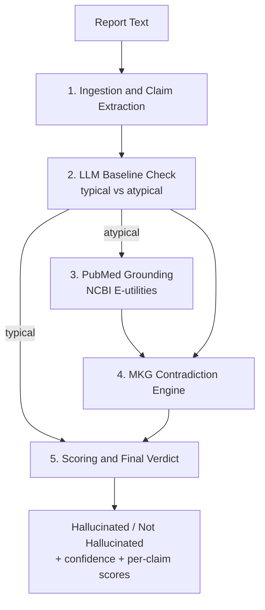

# RadCheck RAG: Hallucination Detection in Radiology Reports using Agentic Medical Graph-RAG


> **Final Year Project, B.Tech Computer Science & Engineering**
> Amrita Vishwa Vidyapeetham
> Author: **[Your Name]** | Guide: **[Guide Name]** | Academic Year: **[Year]**

---

## Table of Contents

1. [Abstract](#1-abstract)
2. [Motivation and Problem Statement](#2-motivation-and-problem-statement)
3. [Objectives and Contributions](#3-objectives-and-contributions)
4. [System Architecture](#4-system-architecture)
5. [Methodology](#5-methodology)
6. [Repository Structure](#6-repository-structure)
7. [Installation and Setup](#7-installation-and-setup)
8. [Usage](#8-usage)
9. [Experimental Evaluation](#9-experimental-evaluation)
10. [Discussion](#10-discussion)
11. [Limitations and Threats to Validity](#11-limitations-and-threats-to-validity)
12. [Future Work](#12-future-work)
13. [Ethical Considerations](#13-ethical-considerations)
14. [Reproducibility Notes](#14-reproducibility-notes)
15. [References](#15-references)
16. [Citation](#16-citation)
17. [Acknowledgements and License](#17-acknowledgements-and-license)

---

## 1. Abstract

Large language models are increasingly used to draft radiology and clinical reports, but they can produce **hallucinations**: statements that are fluent and confident yet clinically wrong, self-contradictory, or anatomically impossible. **RadCheck RAG** is a verification pipeline that detects such hallucinations in free-text reports. It extends **AMG-RAG** (Autonomous Medical Knowledge Graph RAG), originally designed for medical question answering, to the report-verification setting.

The system decomposes a report into atomic clinical claims and screens each one for typicality using an LLM baseline check. Claims judged atypical are grounded against PubMed literature. A **Medical Knowledge Graph (MKG)** is then built over all claims, and a dedicated contradiction engine searches it for internal inconsistencies. Each claim receives a grounding score, and the report receives a verdict (**Hallucinated** or **Not Hallucinated**) with a confidence value.

On a labeled set of 23 reports (13 hallucinated, 10 clean), the proposed design (System A) reaches **86.96% accuracy and an F1-score of 88.00%**. A simpler single-verifier baseline (System B) reaches 73.91% accuracy and 76.92% F1 under the same LLM.

---

## 2. Motivation and Problem Statement

Radiology reports directly influence diagnosis and treatment. As generative AI enters clinical documentation, three kinds of error become critical:

| Error type | Example |
|---|---|
| **Self-contradiction** | "Heart is of normal size with severe acute cardiomegaly" |
| **Cross-claim contradiction** | "Massive consolidations in both lungs" and "completely clear lung fields" |
| **Anatomical or clinical implausibility** | Findings attributed to the wrong substructure, or impossible combinations |

Existing approaches have clear limits:

- **Plain LLM judging** is not grounded in evidence and tends to over-flag or under-flag.
- **Always-on retrieval** is slow and noisy, because it retrieves literature even for routine findings.
- **Claim-level checks alone** miss contradictions that only appear when claims are compared with each other.

**Problem statement:** *Given a free-text clinical report, decide whether it contains hallucinated content, and justify the decision at the claim level using literature grounding and structural consistency checks.*

---

## 3. Objectives and Contributions

**Objectives**

1. Adapt AMG-RAG from multiple-choice QA to claim-level report verification.
2. Reduce unnecessary retrieval by gating literature grounding on claim typicality.
3. Detect cross-claim inconsistencies explicitly using a knowledge graph.
4. Produce interpretable, claim-level scores together with a report-level verdict.
5. Compare the proposed architecture against a simpler baseline under controlled conditions.

**Contributions**

- A five-stage report-verification pipeline (`AMG_RAG_ReportSystem`).
- A **typical/atypical gating** step that triggers PubMed retrieval only when needed.
- An **MKG contradiction engine** with a post-hoc `attribute_type` guard that removes false conflict pairs.
- A transparent **scoring scheme** that combines literature support and contradiction severity.
- A same-LLM comparison of two architectures (System A vs. System B), so the results reflect pipeline design and not model choice.
- An adapted AMG-RAG medical QA pipeline and supporting evaluation notebooks, including a false-positive check on real chest X-ray reports.

---

## 4. System Architecture



Plain-text view of the same flow:

```
Report text
   │
   ▼
1. Report Ingestion & Extraction ── LLM parses claims → (finding, anatomical target,
   │                                 clinical status, attribute_type)
   ▼
2. LLM Baseline Check ──────────── each claim labelled "typical" or "atypical"
   │                                 (rare, impossible, self-contradictory, wrong substructure counts)
   ▼
3. PubMed Grounding ────────────── run ONLY for atypical claims (NCBI E-utilities)
   │
   ▼
4. MKG Contradiction Engine ────── build graph  Anatomy ──has_finding──▶ Claim_i
   │                                 LLM detects: same-structure/same-attribute conflicts,
   │                                 self-contradictions, anatomically impossible claims
   │                                 + post-hoc guard drops pairs with different attribute_type
   ▼
5. Final Verdict ───────────────── grounding score per claim, overall confidence, verdict
```

### Design rationale

| Design choice | Reason |
|---|---|
| Atomic claim extraction | Lets errors be localized and scored per claim. |
| Typicality gating | Skips retrieval for routine findings, which cuts cost and retrieval noise. |
| PubMed grounding | Gives atypical claims an evidence-based signal. |
| Graph-structured contradiction search | Groups claims by anatomical structure so conflicts are compared on the same target. |
| `attribute_type` guard | Prevents false contradictions between unrelated attributes of the same organ (e.g., size vs. opacity). |

---

## 5. Methodology

### 5.1 Claim extraction
The LLM parses the report into structured tuples:
`(finding, anatomical_target, clinical_status, attribute_type)`.

### 5.2 Baseline typicality check
Each claim is labelled **typical** or **atypical**. A claim is atypical if it is rare, impossible, self-contradictory, or assigns a count to the wrong substructure.

### 5.3 Literature grounding
For atypical claims only, PubMed is queried through NCBI E-utilities. A claim is marked *supported* or *unsupported* based on the retrieved evidence.

### 5.4 MKG construction and contradiction detection
A graph is built with edges `Anatomy ──has_finding──▶ Claim_i`. The LLM inspects claims attached to the same structure and flags:

- same-structure, same-attribute conflicts
- self-contradictions within one claim
- anatomically impossible claims

A post-hoc guard discards any contradiction pair whose claims have different `attribute_type` values.

### 5.5 Scoring and verdict

| Claim state | Starting grounding score |
|---|---|
| Typical | 1.0 |
| Atypical, supported by PubMed | 0.7 |
| Atypical, no PubMed support | 0.3 |

For each contradiction involving a claim, the contradiction severity `s ∈ [0, 1]` is subtracted:

```
score(claim) = base_score(claim) − Σ severity(contradiction_k)
```

- A claim with `score < 0.5` is marked **hallucinated**.
- A report is flagged **Hallucinated** if *any* claim is hallucinated.
- **Overall confidence** is the mean of all claim scores.

### 5.6 Baseline: System B
System B is a single-verifier design with no typicality gating and no dedicated contradiction engine. Every finding is verified in one combined check, with always-on PubMed/Wikipedia retrieval.

### 5.7 Medical QA pipeline (original AMG-RAG)
`RAG_QUESTION.py` answers MedQA-style multiple-choice questions in six steps:

1. Entity extraction with relevance scores (1–10)
2. KG construction with bidirectional relations (treats, causes, symptom_of, …)
3. Multi-source retrieval (PubMed, Wikipedia, vector DB)
4. Entity summarization and confidence update
5. Chain-of-thought reasoning over graph paths using confidence-pruned DFS
6. Final answer (A–E) with confidence score and explanation

---

## 6. Repository Structure

```
.
├── RAG_REPORT.py                                  # Main system: AMG_RAG_ReportSystem (System A)
├── RAG_QUESTION.py                                # AMG-RAG medical QA pipeline (6 steps)
├── Simple_AMG_RAG.py                              # Baseline AMG-RAG QA with LangGraph (GPT-4o)
├── RadCheck_RAG_Architecture_Comparison.ipynb     # System A vs System B on 23 labeled reports
├── System_B_Evaluation_1.ipynb                    # Standalone System B evaluation
├── LAST.ipynb                                     # False-positive check on Indiana Univ. CXR reports
├── Evaluate_RAG_Confidence 1.ipynb                # "Verifying the verifier" on MIMIC-CXR (Groq)
├── Evaluate_RAG_Confidence_Cerebras.ipynb         # Same experiment (Cerebras backend)
├── system_a_results.json                          # Per-report results, System A
├── system_b_results.json                          # Per-report results, System B
├── RAG.pdf                                        # Reference paper / design notes
├── Results/                                       # Pipeline screenshots and metrics chart
└── README.md
```

| File | Purpose |
|---|---|
| `RAG_REPORT.py` | Report hallucination detection (5-step pipeline). |
| `RAG_QUESTION.py` | Medical multiple-choice QA. |
| `Simple_AMG_RAG.py` | Baseline QA pipeline (VectorDB → PubMed → CoT → answer). |
| Notebooks | Evaluation, comparison, and robustness experiments. |
| `*_results.json` | Raw outputs for reproducing the metrics. |

---

## 7. Installation and Setup

### Prerequisites
- Python 3.10+
- A Google GenAI API key
- (Optional) An NCBI API key, which raises the PubMed rate limit from 3 to 10 requests/s

### Install

```bash
git clone <your-repo-url>
cd <repo-folder>

python -m venv venv
source venv/bin/activate        # Windows: venv\Scripts\activate

pip install langchain-google-genai langchain-classic langchain-core langchain-huggingface \
            langchain-chroma networkx requests wikipedia python-decouple

# for notebooks
pip install pandas tqdm scikit-learn matplotlib seaborn
```

### Configure environment variables

Create a `.env` file in the project folder:

```env
GOOGLE_API_KEY=your_google_genai_key
pubmed_api=your_ncbi_key        # optional
```

`Simple_AMG_RAG.py` additionally requires `OPENAI_API_KEY`, a Neo4j driver, and a local `create_VDB.MedicalQAChromaDB` module that is **not included** in this repository.

> Never commit API keys. Provide them through `.env` or `getpass`.

---

## 8. Usage

```bash
python RAG_REPORT.py      # report hallucination detection demo
python RAG_QUESTION.py    # medical QA demo (inferior-wall MI question)
```

`RAG_REPORT.py` runs two demos:

- **Normal report:** "The heart is of normal size… lungs are clear…". Expected verdict: *Not Hallucinated*.
- **Hallucinated report:** "normal size with severe acute cardiomegaly", "massive consolidations… with completely clear lung fields", "widened and perfectly normal" mediastinum. Expected verdict: *Hallucinated*.

| Step 1: Extraction | Steps 3–4: Grounding + MKG |
|---|---|
|  |  |

Further screenshots are in [`Results/`](Results/).

### Example output (illustrative)

```json
{
  "verdict": "Hallucinated",
  "overall_confidence": 0.41,
  "claims": [
    {"claim": "normal heart size", "label": "typical", "score": 1.0},
    {"claim": "severe acute cardiomegaly", "label": "atypical", "pubmed_support": false, "score": 0.0}
  ],
  "contradictions": [
    {"claims": [0, 1], "type": "same-attribute conflict", "severity": 1.0}
  ]
}
```

> The JSON above is a schematic example. Exact field names depend on the implementation in `RAG_REPORT.py`.

---

## 9. Experimental Evaluation

### 9.1 Setup

| Item | Value |
|---|---|
| LLM (both systems) | `gemma-4-31b-it` via Google GenAI API |
| Test set | 23 labeled reports (13 hallucinated, 10 clean) |
| Positive class | Hallucinated |
| Metrics | Accuracy, Precision, Recall, F1, Specificity, mean latency per report |
| Controlled variable | Same LLM for both systems, so differences come from pipeline design |

### 9.2 System comparison

| | **System A** (`RAG_REPORT.py`) | **System B** (single verifier) |
|---|---|---|
| Typical/atypical gating | Yes | No |
| Literature grounding | PubMed, atypical claims only | PubMed/Wikipedia, always |
| Dedicated contradiction engine | Yes | No |
| **Accuracy** | **86.96%** | 73.91% |
| **Precision** | **91.67%** | 76.92% |
| **Recall** | **84.62%** | 76.92% |
| **F1-score** | **88.00%** | 76.92% |
| **Specificity** | **90.00%** | 70.00% |
| Mean latency / report | 102.7 s | **57.5 s** |


### 9.3 Confusion matrices (derived from the reported metrics)

| | System A: Pred. Hallucinated | System A: Pred. Clean | System B: Pred. Hallucinated | System B: Pred. Clean |
|---|---|---|---|---|
| **Actual Hallucinated (13)** | TP = 11 | FN = 2 | TP = 10 | FN = 3 |
| **Actual Clean (10)** | FP = 1 | TN = 9 | FP = 3 | TN = 7 |

### 9.4 Additional experiments

| Notebook | Question answered |
|---|---|
| `LAST.ipynb` | What is the false-positive rate of System A on real Indiana University chest X-ray reports? |
| `Evaluate_RAG_Confidence*.ipynb` | Does the verifier behave consistently on MIMIC-CXR ground-truth reports? (Groq / Cerebras backends) |
| `System_B_Evaluation_1.ipynb` | Standalone profile of the single-verifier baseline. |

---

## 10. Discussion

- **Accuracy:** System A is better on every metric. The explicit contradiction engine most likely accounts for the gain on cross-claim conflicts, which a single per-finding check does not see.
- **False alarms:** System A produced 1 false positive against 3 for System B. In a clinical setting, fewer false alarms reduce alert fatigue.
- **Cost:** System A is about **1.8× slower** (102.7 s vs. 57.5 s) because of the extra baseline-check and contradiction-engine LLM calls. Typicality gating limits the retrieval overhead but does not remove the cost of these calls.
- **Trade-off:** The pipeline favors precision and interpretability over speed, which suits offline report auditing better than real-time use.

---

## 11. Limitations and Threats to Validity

- **Small test set.** With 23 reports, the metrics have wide confidence intervals and are indicative, not conclusive.
- **Synthetic or curated labels.** Hallucinations in the test set may be easier to detect than subtle real-world errors.
- **Single LLM.** Results may change with a different backbone model.
- **LLM-as-judge dependence.** Typicality and contradiction judgments are made by an LLM and can be non-deterministic.
- **Literature coverage.** PubMed absence of evidence is not evidence of absence, so rare but true findings may be under-scored.
- **Scope.** The pipeline checks internal consistency and plausibility. It does **not** compare the report against the underlying image.
- **Latency.** At about 100 s per report, the system is not suitable for real-time clinical use.
- **Not a medical device.** Outputs have not been clinically validated.

---

## 12. Future Work

- Evaluate on larger public datasets (e.g., MIMIC-CXR, IU X-Ray) with expert-annotated hallucinations, and report confidence intervals.
- Add image-grounded verification with a vision-language model so report claims can be checked against the radiograph.
- Replace the heuristic scoring with calibrated confidence and run threshold-sensitivity analysis.
- Run ablations of gating, grounding, contradiction engine, and `attribute_type` guard.
- Reduce latency through parallel claim processing, caching, and smaller specialist models.
- Extend the MKG with UMLS/SNOMED/RadLex ontologies for standardized anatomy and finding relations.
- Benchmark across multiple LLM backbones.
- Evaluate with radiologists in the loop.

---

## 13. Ethical Considerations

- This is a **research prototype for decision support**, not a diagnostic tool.
- Final clinical judgment must remain with qualified professionals.
- Data used in experiments should be de-identified and used under the original dataset licenses and data-use agreements (e.g., MIMIC-CXR requires credentialed access).
- No patient-identifiable information should be sent to third-party LLM APIs without authorization.

---

## 14. Reproducibility Notes

- The notebooks are written for **Google Colab**.
- In the comparison notebook, **restart the runtime between Part 1 (System A) and Part 2 (System B)**, because the two systems pin conflicting LangChain versions.
- Raw per-report outputs are in `system_a_results.json` and `system_b_results.json`, so the metrics can be recomputed without re-running the LLM.
- LLM outputs are non-deterministic, so small variations between runs are expected.
- Record the model name, date, and library versions with every run (`pip freeze > requirements.txt`).

---

## 15. References

1. **[AMG-RAG]** Autonomous Medical Knowledge Graph RAG. See [`RAG.pdf`](RAG.pdf) for the reference paper and design notes.
2. NCBI E-utilities (PubMed API): https://www.ncbi.nlm.nih.gov/books/NBK25501/
3. Johnson et al., *MIMIC-CXR*, a de-identified publicly available database of chest radiographs with free-text reports.
4. Demner-Fushman et al., *Preparing a collection of radiology examinations for distribution and retrieval* (Indiana University Chest X-ray collection).
5. Lewis et al., *Retrieval-Augmented Generation for Knowledge-Intensive NLP Tasks*, NeurIPS 2020.
6. LangChain / LangGraph documentation.

> Replace or extend with full bibliographic entries (authors, venue, year, DOI) as required by your department's format.

---

## 16. Citation

```bibtex
@misc{radcheckrag2026,
  title        = {RadCheck RAG: Hallucination Detection in Radiology Reports using Agentic Medical Graph-RAG},
  author       = {[Your Name]},
  year         = {2026},
  howpublished = {Final Year Project, Amrita Vishwa Vidyapeetham},
  note         = {Guide: [Guide Name]}
}
```

---

## 17. Acknowledgements and License

I thank **[Guide Name]** and the Department of Computer Science & Engineering, Amrita Vishwa Vidyapeetham, for their guidance and support.

Released under the **MIT License** (see `LICENSE`). Update this if your institution or dataset terms require otherwise.
