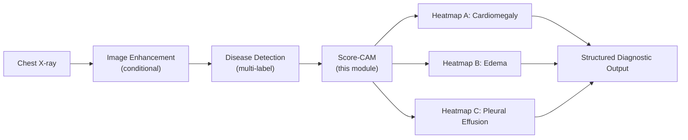

# ReXTrust: Disease-Specific Explainability with Score-CAM

### Independent Per-Disease Saliency Maps for Multi-Label Chest X-ray Classifiers


> **Final Year Project, B.Tech Computer Science & Engineering**
> Amrita Vishwa Vidyapeetham, Coimbatore
> **Project:** ReXTrust | **Team:** VLIL Team 95
> **Domain:** Explainable AI · Medical Imaging · Deep Learning

---

## Table of Contents

1. [Abstract](#1-abstract)
2. [Key Results at a Glance](#2-key-results-at-a-glance)
3. [Motivation and Problem Statement](#3-motivation-and-problem-statement)
4. [Objectives](#4-objectives)
5. [Where Score-CAM Fits in ReXTrust](#5-where-score-cam-fits-in-rextrust)
6. [Method](#6-method)
7. [Models Explained](#7-models-explained)
8. [Experimental Setup](#8-experimental-setup)
9. [Results](#9-results)
10. [Discussion](#10-discussion)
11. [Limitations](#11-limitations)
12. [Repository Structure](#12-repository-structure)
13. [Installation](#13-installation)
14. [Usage](#14-usage)
15. [Reproducibility](#15-reproducibility)
16. [Future Work](#16-future-work)
17. [Responsible Use](#17-responsible-use)
18. [References](#18-references)

---

## 1. Abstract

A multi-label chest X-ray classifier can predict several findings for the same radiograph. Common saliency methods are usually shown as **one** heatmap, which cannot show which region supports which prediction.

This module applies **Score-CAM** (Wang et al., 2020) to the four Stage 2 disease-detection models (CNN baseline, CNN matched recipe, Hybrid CNN–Transformer, and CheXGCN). It generates an **independent heatmap for each target disease**: Cardiomegaly, Edema, and Pleural Effusion. Each map is computed from that disease's own class score, so the evidence for every prediction can be inspected separately.

Score-CAM is gradient-free. Each activation map of the final DenseNet121 block is used as a soft mask on the input, the masked image is scored with a forward pass, and the maps are combined using those scores as weights.

Besides qualitative heatmaps, the notebooks include a quantitative check of the maps. It measures how similar the maps of different diseases are (pairwise correlation) and how much of each map falls inside a fixed thorax region. On these exploratory measures, **CheXGCN** produced the most disease-specific and most thorax-focused maps. It was therefore selected as the explanation model in the ReXTrust presentation of results, independently of its AUC/F1 ranking.

---

## 2. Key Results at a Glance

| Item | Value |
|---|---|
| Explanation method | Score-CAM (gradient-free, class-specific) |
| Models explained | CNN (baseline), CNN (matched), Hybrid CNN–Transformer, CheXGCN (6k-scale checkpoints) |
| Target layer | DenseNet121 final block (`norm5` in the notebooks; `denseblock4` in the integrated pipeline) |
| Maps per image | 3 (one per disease) |
| Lowest inter-disease map correlation | **CheXGCN**: 0.15 (Cardiomegaly vs Pleural Effusion) |
| Highest thorax-mass fraction (10 images) | **CheXGCN**: 0.757 / 0.724 / 0.648 (C / E / PE) |
| Masked (centre-crop) variant | Lower test AUC than the unmasked matched CNN on all three diseases |
| Main caveat | Exploratory analysis on 1 image (correlation) and 10 images (thorax mass); geometric thorax proxy |

---

## 3. Motivation and Problem Statement

Disease probabilities alone do not show *where* in the image the model found its evidence. For multi-label prediction the problem is sharper, because a single blended saliency map cannot separate the evidence for co-occurring findings.

**Problem statement:** *For every disease predicted by a multi-label chest X-ray classifier, produce a separate, spatially interpretable explanation, and assess whether these explanations actually differ between diseases and focus on the thorax.*

---

## 4. Objectives

1. Generate one Score-CAM heatmap **per target disease** instead of a single blended map.
2. Apply the same explanation procedure to all four Stage 2 detection techniques so they can be compared.
3. Verify that the target layer produces non-degenerate maps.
4. Quantify how distinct the per-disease maps are, and how strongly they concentrate on the thorax.
5. Examine whether removing the image border (centre crop) changes model behaviour.
6. Provide the per-disease heatmaps to the ReXTrust structured output.

---

## 5. Where Score-CAM Fits in ReXTrust



Score-CAM receives the detection model and the (enhanced or unchanged) image. It returns three heatmaps that are overlaid on the radiograph in the final output, next to each disease's probability and decision threshold.

---

## 6. Method

### 6.1 Score-CAM

For an input image `x`, a classifier `f`, and the activation maps `A_k` (k = 1 … 1024) of the target layer:

```text
1. U_k   = bilinear_upsample(A_k)  to the input size (224 x 224)
2. H_k   = (U_k - min U_k) / (max U_k - min U_k)        # soft mask in [0, 1]
3. s_k,c = f_c(x ⊙ H_k)                                   # class-c score of the masked input
4. α_k,c = softmax_k(s_k,c)                               # weight of map k for class c
5. L_c   = ReLU( Σ_k α_k,c · U_k )                         # saliency map for class c
```

The map `L_c` is min–max normalised and overlaid on the image.

### 6.2 Independent Per-Disease Maps

Step 3 is evaluated for **each disease separately** (target = that disease's own logit), so ReXTrust produces three independent maps:

| Output | Class score used |
|---|---|
| Heatmap A | Cardiomegaly logit |
| Heatmap B | Edema logit |
| Heatmap C | Pleural Effusion logit |

In the integrated pipeline (`Complete Pipeline/pipeline_core.py`), every masked forward pass returns all three logits, so **one sweep over the channels** provides the weights for all three diseases. On CPU, the sweep can be limited to the 256 highest-variance channels to reduce run time.

### 6.3 Why Score-CAM

- **Gradient-free:** avoids noisy or saturated gradients in deep CNNs (compared with Grad-CAM).
- **Model-agnostic within this project:** the same code explains all four detectors.
- **Class-specific:** the explanation is tied directly to one disease's output score.

### 6.4 Target Layer

| Setting | Layer | Notes |
|---|---|---|
| Notebooks (`pytorch-grad-cam`) | `backbone.norm5` | Final BatchNorm after the last dense block |
| Integrated pipeline (own implementation) | `backbone.denseblock4` | Last dense block, 1024 × 7 × 7 |

In `scorecam_testing.ipynb`, the library's `ScoreCAM` with `denseblock4` as the target layer produced **all-zero maps** for the test image (identical across diseases, min = max = 0). The same procedure with `norm5` produced non-degenerate, class-dependent maps, so the notebooks use `norm5`.

For CheXGCN, whose `forward(x, adj)` takes two arguments, a small wrapper (`CheXGCNCamWrapper`) fixes the adjacency matrix so that Score-CAM can call `model(x)`. This wrapper is used only for explanation and does not change trained weights or metrics.

---

## 7. Models Explained

All four models come from the Stage 2 disease-detection work (see [`DiseaseDetection/`](../DiseaseDetection/)) at the **6k** scale (6,000 sampled positives per disease plus 6,000 all-negative images, patient-level 70/15/15 split).

| Technique | Architecture | Training recipe |
|---|---|---|
| CNN (baseline) | DenseNet121 → GAP → Linear(3) | BCE, no dropout, no scheduler |
| CNN (matched) | Same as baseline | Focal loss, dropout 0.3, ReduceLROnPlateau |
| Hybrid CNN–Transformer | DenseNet121 tokens + [CLS] → 2-layer Transformer encoder | Matched recipe |
| CheXGCN | DenseNet121 features · GCN over train-split label co-occurrence graph | Matched recipe |

The Hybrid model additionally provides a CLS-token attention-rollout map in the detection notebooks.

---

## 8. Experimental Setup

### 8.1 Fixed Sample Images

`final-rextrust-stage2-scaled-6k-unmasked.ipynb` and `masked-cnn-matched-6k.ipynb` reuse two fixed test images for every technique, so the heatmaps can be compared image-for-image:

| Sample | Ground truth |
|---|---|
| Sample A (all positive) | Cardiomegaly = 1, Edema = 1, Pleural Effusion = 1 |
| Sample B (one positive) | Cardiomegaly = 0, Edema = 1, Pleural Effusion = 0 |

Each heatmap title shows the prediction, the probability, and the ground truth.

### 8.2 Quantitative Map Analysis (`scorecam_testing.ipynb`)

| Analysis | Data | Measure |
|---|---|---|
| Inter-disease similarity | 1 CheXpert validation image | Pearson correlation and mean absolute difference between the maps of two diseases |
| Thorax focus | 10 CheXpert validation frontal images | Fraction of saliency mass inside a fixed elliptical thorax region (centre at 50% width / 55% height, radii 42% of width and height) |

The 6k checkpoints are loaded from the Kaggle model `suryasampreethchirla/6k-models`.

### 8.3 Masked (Centre-Crop) Variant (`masked-cnn-matched-6k.ipynb`)

The matched-recipe CNN is retrained on images from which **15% of the height and width is removed on each side** (`crop_center(img, pct=0.15)`) before resizing to 224 × 224. Training, thresholding, and evaluation follow the same protocol as the unmasked notebook.

---

## 9. Results

### 9.1 Qualitative Per-Disease Heatmaps (CheXGCN, 6k)

- **Sample A (all positive):** all three diseases are predicted correctly (p = 0.41 / 0.44 / 0.53). The three maps highlight different regions: the Cardiomegaly map is centred on the mediastinal/cardiac region, while the Edema and Pleural Effusion maps spread over both lung fields.
- **Sample B (Edema only):** Edema is correctly positive (p = 0.49), and Pleural Effusion is a false positive (p = 0.48). The two maps highlight the **same perihilar region**, which makes the shared evidence behind the false positive visible. A single blended map would hide this.

Heatmap images for all techniques are in `Images/ScoreCAM_Images.zip` (Section 12).

### 9.2 Inter-Disease Map Correlation (1 validation image)

Lower correlation means the maps differ more between diseases.

| Model | Cardio vs Edema | Cardio vs Pl. Effusion | Edema vs Pl. Effusion |
|---|---:|---:|---:|
| CNN (baseline) | 0.8974 | 0.7898 | 0.6604 |
| CNN (matched) | 0.9840 | 0.9722 | 0.9926 |
| Hybrid | 0.9863 | 0.9710 | 0.9529 |
| **CheXGCN** | 0.9761 | **0.1512** | **0.3596** |

### 9.3 Saliency Mass Inside the Thorax Region (10 validation images)

Higher means more of the map lies inside the thorax ellipse.

| Model | Cardiomegaly | Edema | Pleural Effusion |
|---|---:|---:|---:|
| CNN (baseline) | 0.375 | 0.441 | 0.429 |
| CNN (matched) | 0.580 | 0.573 | 0.565 |
| Hybrid | 0.594 | 0.612 | 0.593 |
| **CheXGCN** | **0.757** | **0.724** | **0.648** |

### 9.4 Masked vs Unmasked Matched CNN (6k test set)

| Disease | AUC (unmasked) | AUC (masked) | F1 (unmasked) | F1 (masked) |
|---|---:|---:|---:|---:|
| Cardiomegaly | 0.8166 | 0.8121 | 0.6475 | 0.6434 |
| Edema | 0.7966 | 0.7860 | 0.7191 | 0.7130 |
| Pleural Effusion | 0.8408 | 0.8205 | 0.7670 | 0.7657 |

Unmasked values are from the matched CNN retrained in `final-rextrust-stage2-scaled-6k-unmasked.ipynb`. Masked values are from `masked-cnn-matched-6k.ipynb`. Both use validation-tuned thresholds.

---

## 10. Discussion

- **Per-disease maps are not automatically distinct.** For the matched CNN and the Hybrid, the three maps are almost identical (correlation 0.95–0.99), so they explain "something abnormal" rather than a specific disease.
- **CheXGCN separates the evidence best.** Its Pleural Effusion map is nearly uncorrelated with its other maps, and it places the largest share of saliency inside the thorax. This is why CheXGCN was chosen to present ReXTrust explanations, independently of raw AUC/F1 ranking.
- **Explanations expose errors.** In Sample B, the false-positive Pleural Effusion map overlaps the correct Edema evidence, which illustrates how co-occurrence can drive a wrong prediction.
- **Removing the border did not help classification.** The centre-crop variant had lower AUC on all three diseases than the unmasked matched CNN.
- **Target-layer choice matters.** The same library call gave degenerate (all-zero) maps at `denseblock4` and usable maps at `norm5`, so sanity checks on map statistics are necessary.

---

## 11. Limitations

| Area | Limitation |
|---|---|
| Sample size | Correlation is measured on 1 image and thorax mass on 10 images. A 100-image run was started but did not complete (`NameError` after a session restart). |
| Thorax region | A fixed geometric ellipse, not an anatomical segmentation |
| Input handling | The `scorecam_testing.ipynb` analysis resizes images and converts them to tensors without ImageNet normalisation, unlike training |
| Ground truth | No pixel-level annotations, so localisation accuracy is not measured |
| Faithfulness | Saliency maps show regions associated with model scores, not causal or clinical reasoning |
| Variability | Retrained notebooks give slightly different metrics from the main Stage 2 runs |
| Clinical readiness | Not validated by radiologists |

---

## 12. Repository Structure

```text
ScoreCAM/
│
├── Images/
│   ├── .gitkeep
│   └── ScoreCAM_Images.zip
│       ├── 6k_masked_cnn_matched/
│       │   ├── Masked_CNN_Matched_1.png
│       │   ├── Masked_CNN_Matched_2.png
│       │   └── Masked_Samples.png
│       └── ScoreCAM_Images/
│           ├── CNN_Baseline_ScoreCAM_1.png / _2.png
│           ├── CNN_Matched_ScoreCAM_6k_1.png / _2.png
│           ├── Hybrid_ScoreCAM_1.png / _2.png
│           ├── CheXGCN_ScoreCAM_1.png / _2.png
│           └── Unmasked_Samples.png
│
├── final-rextrust-stage2-scaled-6k-unmasked.ipynb
├── masked-cnn-matched-6k.ipynb
├── scorecam_testing.ipynb
└── README.md
```

| File | Description |
|---|---|
| `final-rextrust-stage2-scaled-6k-unmasked.ipynb` | Full 6k Stage 2 pipeline with per-disease Score-CAM for all four techniques on two fixed samples |
| `masked-cnn-matched-6k.ipynb` | Matched CNN retrained with a 15% centre crop, with Score-CAM on the same samples |
| `scorecam_testing.ipynb` | Target-layer debugging, inter-disease correlation, and thorax-mass analysis using saved 6k checkpoints |
| `Images/ScoreCAM_Images.zip` | Saved heatmap figures for every technique (unmasked and masked) |

The integrated Score-CAM implementation used by the end-to-end application is in [`Complete Pipeline/pipeline_core.py`](../Complete%20Pipeline/pipeline_core.py) (`score_cam`, `overlay`).

---

## 13. Installation

### 13.1 Prerequisites

- Python 3.10 or a compatible version
- Access to the CheXpert dataset
- Trained Stage 2 checkpoints (see [`DiseaseDetection/Models/`](../DiseaseDetection/Models/))
- Jupyter Notebook or Kaggle Notebooks; a CUDA-capable GPU is recommended

### 13.2 Clone the Repository

```bash
git clone https://github.com/SuryaSampreeth/VLIL-Team-95.git
cd VLIL-Team-95/ScoreCAM
```

### 13.3 Install Dependencies

```bash
python -m pip install --upgrade pip
python -m pip install grad-cam numpy pandas opencv-python matplotlib scikit-learn jupyter
```

Install PyTorch and Torchvision with the official selector: https://pytorch.org/get-started/locally/

---

## 14. Usage

### Option A: Notebooks

1. Open a notebook in Kaggle or Jupyter.
2. Attach the CheXpert dataset and set `DATA_ROOT` (or the image path in `scorecam_testing.ipynb`).
3. For `scorecam_testing.ipynb`, attach the 6k model checkpoints and set `model_dir`.
4. Run the cells in order.

### Option B: Integrated Pipeline

```python
import pipeline_core as pc   # inside "Complete Pipeline/"

enh  = pc.enhance_image("1.jpg")
cams = pc.score_cam(enh["enhanced"], "CheXGCN (label graph)")   # {disease: heatmap}
over = pc.overlay(enh["enhanced"], cams["Edema"])                 # RGB overlay
```

The Gradio interface (`python app.py` in `Complete Pipeline/`) can draw heatmaps for the selected detector or for all four detectors.

---

## 15. Reproducibility

| Configuration | Value |
|---|---|
| Seed | 42 (Python, NumPy, PyTorch) |
| Input size | 224 × 224, ImageNet normalisation (training/evaluation) |
| Data scale | 6k positives per disease + 6k all-negative pool |
| Split | Patient-level 70 / 15 / 15, zero overlap verified |
| Score-CAM library | `pytorch-grad-cam` (`pip install grad-cam`) |
| Fixed samples | Sample A (all positive), Sample B (Edema only) from the test split |

Fixed seeds improve repeatability but do not guarantee identical maps across hardware, library versions, or retrained checkpoints.

---

## 16. Future Work

- Repeat the quantitative analysis on a larger image set (the planned 100-image run).
- Replace the geometric ellipse with lung/heart segmentation masks.
- Compare against Grad-CAM and other attribution methods, and run sanity checks (e.g. model-randomisation tests).
- Collect radiologist ratings or pixel-level annotations to measure localisation quality.
- Apply ImageNet normalisation consistently in the analysis notebook.
- Study why the matched-recipe and Hybrid models produce nearly identical maps across diseases.

---

## 17. Responsible Use

This module is intended for **research and educational purposes only**.

- Saliency maps are not lesion segmentations and do not prove clinically valid reasoning.
- Heatmaps may highlight irrelevant regions, including text markers or devices.
- Do not use these outputs for clinical decisions without independent validation and expert oversight.
- Use CheXpert under its access and usage terms, and do not commit patient-identifying data or credentials.

---

## 18. References

1. Wang, H. et al. "Score-CAM: Score-Weighted Visual Explanations for Convolutional Neural Networks." CVPR Workshops, 2020.
2. Selvaraju, R. R. et al. "Grad-CAM: Visual Explanations from Deep Networks via Gradient-Based Localization." ICCV, 2017.
3. Zhou, B. et al. "Learning Deep Features for Discriminative Localization." CVPR, 2016.
4. Huang, G. et al. "Densely Connected Convolutional Networks." CVPR, 2017.
5. Chen, B. et al. "Label Co-Occurrence Learning With Graph Convolutional Networks for Multi-Label Chest X-Ray Image Classification." IEEE JBHI, 2020.
6. Abnar, S. and Zuidema, W. "Quantifying Attention Flow in Transformers." ACL, 2020.
7. Irvin, J. et al. "CheXpert: A Large Chest Radiograph Dataset with Uncertainty Labels and Expert Comparison." AAAI, 2019.
8. Gildenblat, J. and contributors. "PyTorch library for CAM methods." https://github.com/jacobgil/pytorch-grad-cam

---

**ReXTrust | Score-CAM Explainability**

*Research and educational use only.*
